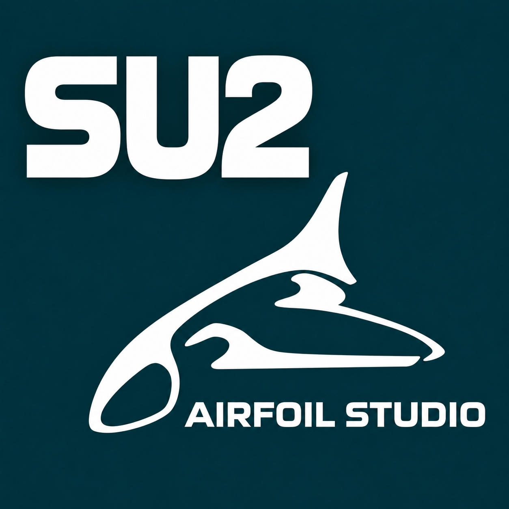
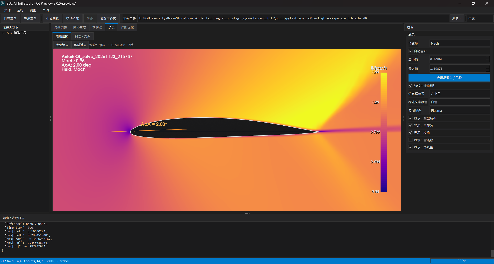
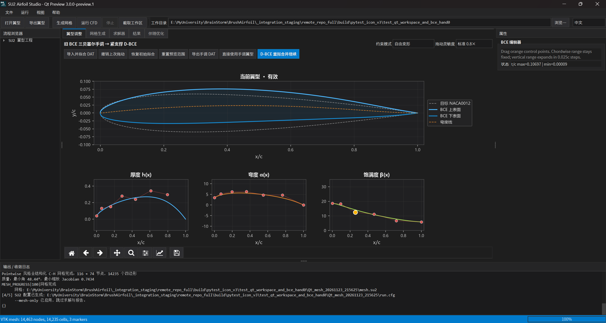
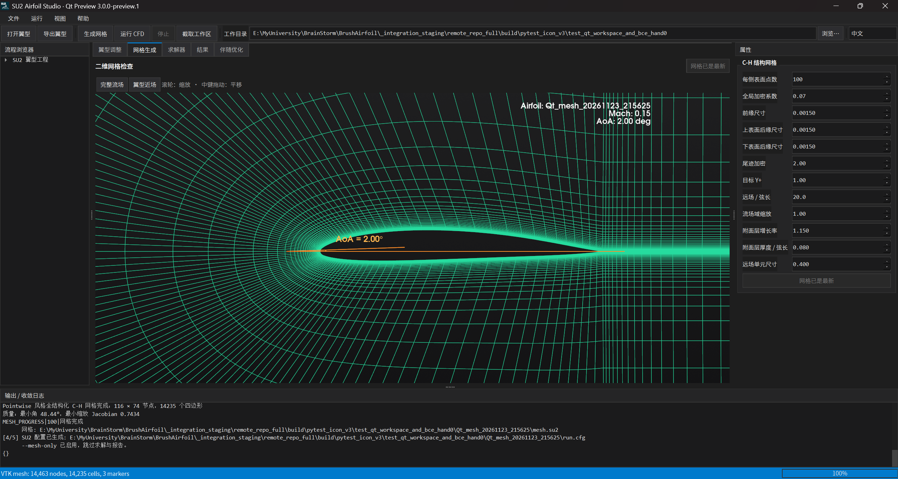
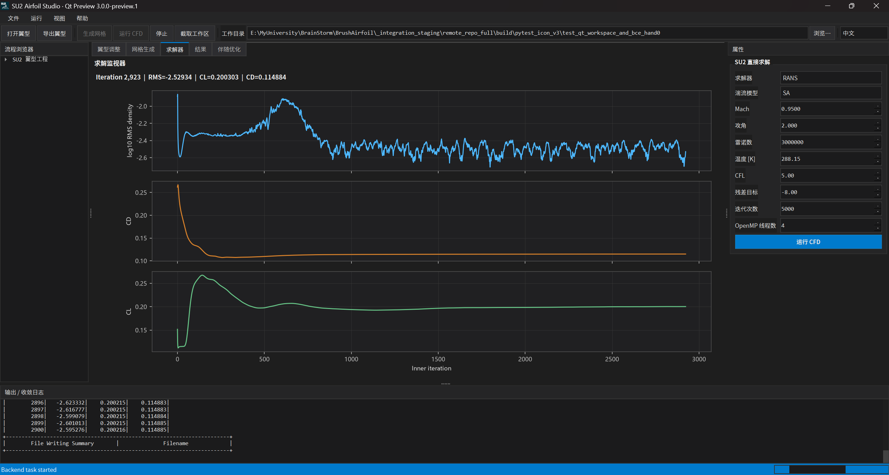
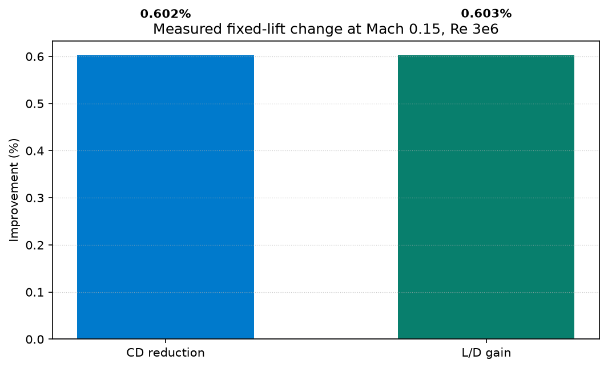

<div align="center">



# SU2 Airfoil Studio

### A desktop environment for 2-D airfoil design, structured meshing, SU2 and discrete-adjoint optimization

**[简体中文](README.zh-CN.md) | [English](README.en.md) | [Language home](README.md)**

[](https://github.com/Phiphi007/SU2-Airfoil-Studio/releases/latest)
[](https://github.com/Phiphi007/SU2-Airfoil-Studio/actions/workflows/tests.yml)
[](LICENSE)

</div>



## Download and launch

Download `SU2_Airfoil_Studio_V1.0.1_Windows_x64.zip` from [GitHub Releases](https://github.com/Phiphi007/SU2-Airfoil-Studio/releases/tag/v1.0.1), verify SHA-256, extract the complete folder and run `SU2_Airfoil_Studio_Qt.exe`.

- Windows 10/11 x64 is supported.
- SU2 8.5.0 direct, discrete-adjoint and deformation tools plus Gmsh are bundled.
- Python is not required.
- Do not copy the main EXE by itself. `_internal`, `solvers`, `assets` and the documentation are part of the runtime.

## What it is

SU2 Airfoil Studio is a professional desktop application for 2-D airfoil design and aerodynamic optimization. Its PySide6 + VTK workspace follows a compact industrial layout. The legacy three-curve BCE editor remains available for manual control-point design, while the resulting geometry is handed without a shape jump to D-BCE, CST, hybrid or CST-to-D-BCE relay optimization. Meshes, logs, convergence plots and contours remain embedded without recurring console windows.

Core capabilities:

- Legacy three-curve BCE editing, constraint modes, undo and DAT export.
- Mesh-resolved compact-support D-BCE local brushes.
- CST, D-BCE, hybrid and relay parameterizations.
- Pointwise-style all-quadrilateral C-H structured meshes.
- SU2 direct solves, live residual/CL/CD monitoring and two safe stop modes.
- Configurable VTK contours, pressure plots, reports and discrete-adjoint optimization.

## Workspace at a glance

| Airfoil design | C-H structured mesh |
|---|---|
|  |  |
| **Live solver monitor** | **Results and contours** |
|  |  |

> The solver screenshot demonstrates live monitoring. Its transonic trial does not satisfy this project's convergence criteria and is not presented as validated CFD data.

## Measured end-to-end result

On 2026-11-23, a strict fixed-lift NACA0012 workflow was completed with SU2 8.5.0. The baseline was continued for 2400 iterations until its force window stabilized, followed by local-polar measurements, DRAG/LIFT discrete adjoints, DOT, four-variable D-BCE, SU2_DEF and three angle-of-attack trim solves. Conditions were Mach 0.15 and Re=3×10⁶ with `CLtarget=0.21585257`.

| Metric | Baseline | Optimized | Change |
|---|---:|---:|---:|
| CD | 0.02112409 | 0.02099670 | **−0.6031%** |
| CL | 0.21585257 | 0.21584208 | −0.00486% |
| Absolute CL error | — | 1.0485×10⁻⁵ | Pass |
| CL/CD | 10.21831 | 10.27981 | **+0.6018%** |
| Density residual log10 | −6.7034 | −7.7034 | Lower |
| Optimization after calibration | — | **544.58 s** | Measured |
| Full workflow | — | **856.04 s** | Measured |



See the [case study](examples/case_studies/naca0012_dbce_fixed_lift/CASE_STUDY.md) for configurations, raw SU2 histories, before/after DAT files, reproduction scripts and the audit explaining why an unconverged baseline once created a false 3.078% drag-reduction claim. This supports about 0.60% fixed-lift improvement for this condition; it is not a universal claim that D-BCE outperforms CST.

## Workflow

### 1. Workspace and airfoil

Select a working directory first. Start from a built-in NACA section, import a Selig-order `.dat`, or open an existing `.su2` mesh. Generated files go to the current case directory and the source DAT is never overwritten.

### 2. Legacy BCE manual design

The editor starts from an analytic sharp-trailing-edge NACA0012 and retains red control points for the three Bézier curves `h(x)`, `α(x)` and `β(x)`. BCE contributes increments relative to its fitted baseline, so startup and reset preserve the exact target. Free, Lock thickness and Lock camber modes, drag sensitivity, undo, restore, stable limits and invalid-geometry blocking are included.

### 3. D-BCE handoff and local brushes

The manual geometry becomes the exact downstream baseline; compact brushes define optimization directions rather than replacing the edited curve. The dictionary enforces a minimum brush half-width and enough CFD wall support nodes, preventing a continuous brush from becoming faceted or oscillatory after discretization.

### 4. Mesh generation

Configure surface samples, global refinement, leading/trailing-edge sizes, target Y+, boundary-layer growth and farfield scale. The mesh view is strictly two-dimensional with zoom and pan only. Changing geometry or mesh settings highlights the update button. Inspect leading-edge resolution, first-layer height, growth, block interfaces, minimum Jacobian and maximum aspect ratio. Existing Pointwise/Gmsh `.su2` grids can also be imported.

### 5. Solver

Set Mach, Reynolds number, angle of attack, turbulence model, CFL, iterations and residual target. Logs, density residual, CD and CL are displayed together.

- **Pause/Resume:** suspend or resume the actual SU2 child process.
- **Stop now:** terminate immediately while retaining files already written.
- **Stop after save:** wait for the next output cycle and stable flow/restart files.

A normal process exit is not automatically labeled converged. Inspect final residuals and late force windows.

### 6. Results and contours

The Results page displays Mach, pressure, Cp, temperature, Y+ and other arrays. Jet, Turbo, Viridis, Plasma, Coolwarm and grayscale maps are available with automatic or manual limits. Enable chord/AoA annotations and choose overlay position plus black or white text.

### 7. Discrete-adjoint optimization

Establish a trustworthy baseline, then choose CST global search, D-BCE local refinement, hybrid mode or CST→D-BCE relay. Configure fixed-AoA/fixed-lift objectives, camber/thickness modes, variables, geometry constraints, AoA bounds, trust region, adjoint iterations and CFL. Accepted shapes can be exported as `.dat` or discarded.

## BCE and D-BCE mathematics

### Legacy BCE

For `q∈{h,α,β}`, each control function is a Bézier curve:

$$
q(t)=\sum_{i=0}^{n}\binom{n}{i}(1-t)^{n-i}t^i q_i.
$$

The final airfoil is the upper and lower envelope of the local ellipse family:

$$
y_u(x)=\sup_{X}\,y_+(x;X),
\qquad
y_l(x)=\inf_{X}\,y_-(x;X).
$$

Legacy BCE is intuitive for manual design, but trigonometric coupling, sensitivity growth near `D=0` and envelope-owner switching degrade a high-dimensional Jacobian. It is therefore retained primarily as an interactive designer.

### D-BCE

For center `c` and half-width `w`, let `s=(x-c)/w`:

$$
\phi_{c,w}(x)=
\begin{cases}
\exp\!\left(1-\dfrac{1}{1-s^2}\right), & |s|<1,\\
0, & |s|\ge1.
\end{cases}
$$

This is a strictly local $C^\infty$ brush. Camber columns `[φ;φ]` and thickness columns `[φ;−φ]` are naturally decoupled. Candidate columns pass support-node gates, scaling, QR orthogonalization and trust-region control. See [Mathematics](docs/MATHEMATICS.md) for the full derivation.

## Source run and tests

```powershell
.\Setup_Windows.bat
.\Launch_SU2_Airfoil_Qt.bat
```

```powershell
py -3.12 -m venv .venv
.\.venv\Scripts\python.exe -m pip install -r requirements-dev.txt
.\.venv\Scripts\python.exe -m unittest discover -s tests -v
.\.venv\Scripts\python.exe -m pytest tests/test_qt_frontend.py -v
```

## Engineering limits

- One successful optimization does not replace a grid-independence study.
- Fixed-AoA drag reduction is not fixed-lift drag reduction.
- Display smoothing cannot repair under-resolved geometry or CFD error.

## License

The project is released under the [MIT License](LICENSE). Bundled components retain their own licenses; see [THIRD_PARTY_NOTICES.md](THIRD_PARTY_NOTICES.md).

---

**[简体中文](README.zh-CN.md) | [Back to language home](README.md)**
