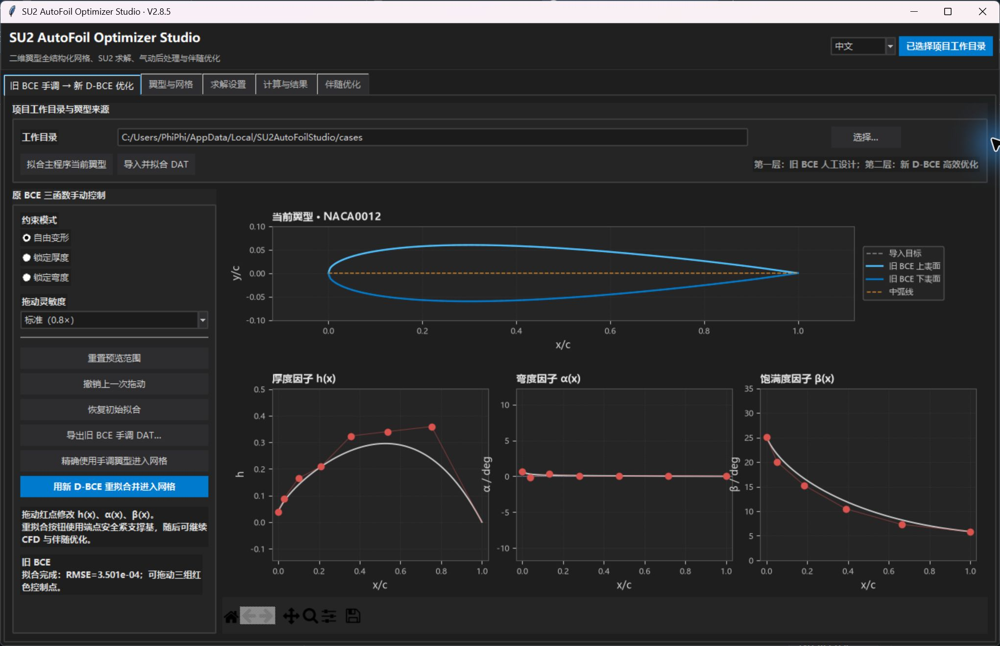
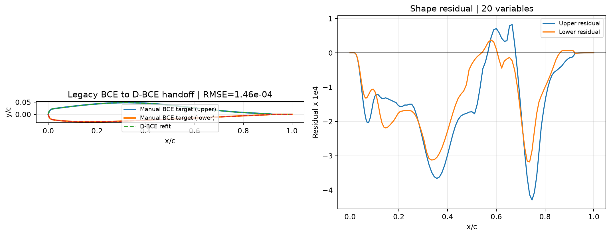
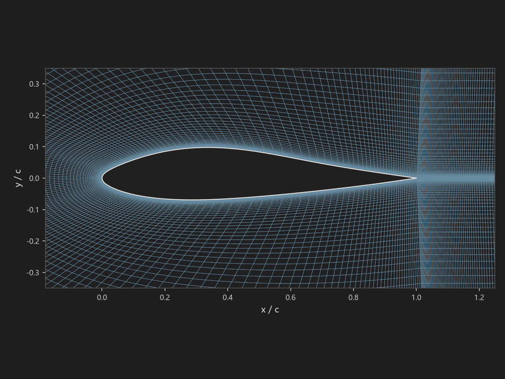
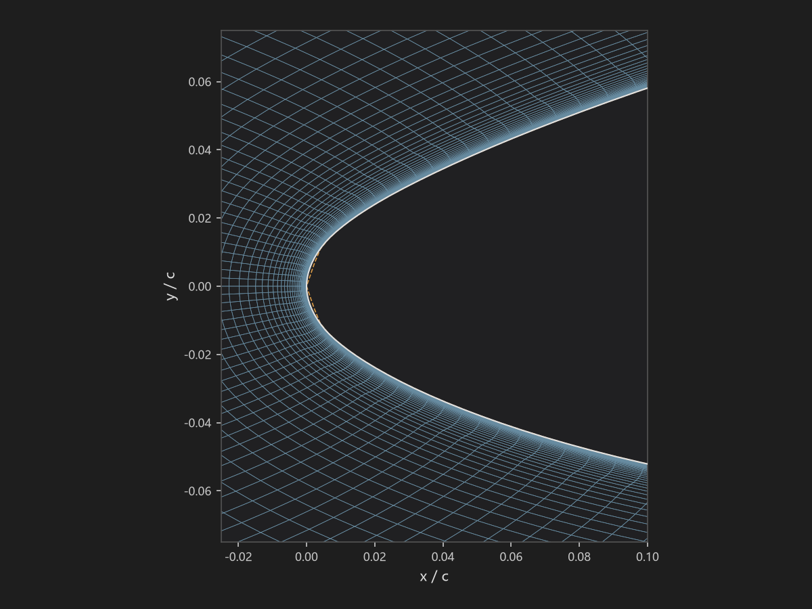
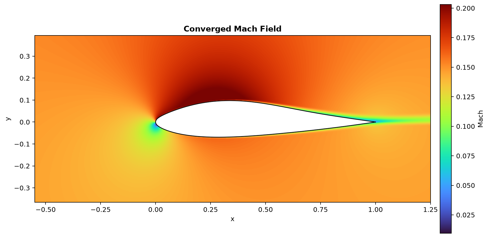
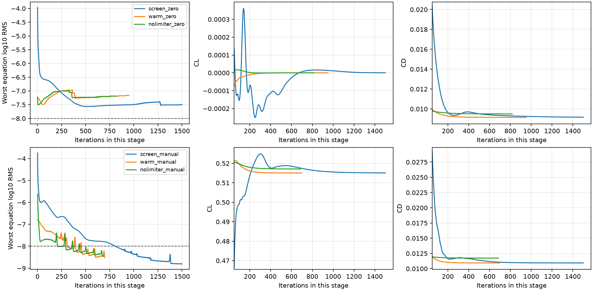

# SU2 Airfoil Studio

**BCE 手动设计 · D-BCE/CST 参数化 · 全四边形 C-H 网格 · SU2 正问题与离散伴随优化**  
**Manual BCE design · D-BCE/CST parameterization · all-quad C-H meshing · SU2 direct and discrete-adjoint optimization**

[](https://github.com/Phiphi007/SU2-Airfoil-Studio/releases/latest)
[](https://su2code.github.io/)
[](https://github.com/Phiphi007/SU2-Airfoil-Studio/actions/workflows/tests.yml)
[](LICENSE)

[下载 Windows 便携版 / Download portable Windows build](https://github.com/Phiphi007/SU2-Airfoil-Studio/releases/latest) · [使用教程 / User guide](docs/USER_GUIDE.md) · [数学原理 / Mathematics](docs/MATHEMATICS.md) · [测试报告 / Testing](docs/TESTING.md)

SU2 Airfoil Studio 是一个面向二维翼型设计与验证的专业桌面工作流。它保留原始 BCE 的三条贝塞尔曲线和拖点交互，允许工程师直观修改厚度、弯度与饱满度；随后可将手调结果无跳变地交给端点安全的紧支撑 D-BCE、CST 或二者的接力优化，并在同一程序内完成网格、SU2 求解、报告与伴随优化。

SU2 Airfoil Studio is a professional desktop workflow for two-dimensional airfoil design and verification. It preserves the original three-curve BCE editor for intuitive thickness, camber and fullness changes, then hands the edited shape to endpoint-safe compact-support D-BCE, CST, or a CST-to-D-BCE relay. Meshing, SU2 execution, reporting and discrete-adjoint optimization live in one application.



## 为什么使用它 / Why use it

- **人机协同设计 / Human-in-the-loop design**：先拖动 `h(x)`、`α(x)`、`β(x)` 控制点形成设计意图，再用 D-BCE 微调。Manual editing remains a first-class operation instead of being replaced by an optimizer.
- **局部且光滑 / Local and smooth**：D-BCE 笔刷具有紧支撑和 $C^\infty$ 光滑性，适合局部压力峰、前缘或尾缘附近的精修。Compact brushes affect only their support while remaining infinitely differentiable.
- **全局与局部接力 / Global-to-local relay**：CST 负责低维全局搜索，D-BCE 负责稀疏局部修正。CST provides global shape changes; D-BCE supplies localized refinement.
- **结构化网格 / Structured mesh**：生成共形、全四边形 C-H 网格，并在导出前检查有向面积、最小角和缩放 Jacobian。Conformal all-quad C-H meshes are quality-gated before export.
- **可追溯计算 / Traceable CFD**：保存配置、网格质量、原始 SU2 历史、表面数据、VTU、收敛图和气动报告。Every run keeps the numerical evidence needed for review.
- **安静的桌面体验 / Quiet desktop workflow**：计算在后台运行，不反复弹出控制台；进度、日志和收敛曲线在程序内显示。Background processes are monitored through the UI.

## 完整工作流 / End-to-end workflow

### 1. 手调 BCE 与 D-BCE 交接 / Manual BCE and D-BCE handoff

导入 Selig 顺序 `.dat` 或使用内置 NACA 翼型。拖动三条贝塞尔曲线控制点；弦长范围固定，纵向显示只在接近边界时分级扩展。结果可直接导出 DAT，也可送入 D-BCE 重拟合。交接保留手调几何，宽重叠笔刷和曲率正则化用于抑制局部波纹。

Import a Selig-order `.dat` file or start from a built-in NACA section. Drag the three Bézier control curves with a fixed chordwise view. Export the manual design directly, or hand it to D-BCE. The handoff preserves the edited geometry while overlapping brushes and curvature regularization suppress local ripples.



### 2. 全四边形 C-H 网格 / All-quad C-H mesh

网格内核使用唯一前缘点和上下两个逻辑后缘端，连接贴壁 C 块、外部 C 块及上下 H 尾迹块。全局加密系数范围为 `0.05–10.0`；流场域缩放范围为 `0.25–10.0`。界面在生成前估算网格规模，生成后显示实际节点、单元和质量指标。

The mesher uses one geometric leading-edge point and two logical trailing-edge ends to connect a wall C-block, an outer C-block and two H-wake blocks. Global refinement spans `0.05–10.0`, while domain scaling spans `0.25–10.0`. Estimated and actual grid sizes are shown in the application.





### 3. SU2 正问题与后处理 / SU2 direct solve and post-processing

可在界面输入 Mach、Reynolds 数、攻角、温度、压力、目标残差和迭代上限，也可直接导入已经在 Pointwise/Gmsh 中定义边界标记的 `.su2` 网格。实时日志和收敛曲线并列显示；云图支持自动色阶和用户指定范围。显示平滑只作用于绘图副本，原始 `flow.vtu` 与 `surface_flow.csv` 不变。

Mach number, Reynolds number, angle of attack, temperature, pressure, residual target and iteration limit are configurable. Existing `.su2` meshes with pre-defined boundary markers can also be imported. Live logs and convergence plots share one view. Contours support automatic or user-defined ranges; display smoothing never modifies raw SU2 data.





### 4. 伴随优化 / Discrete-adjoint optimization

优化模块可选择 CST、D-BCE、混合或 CST→D-BCE 接力；支持固定攻角和固定升力目标、弯度/厚度/联合模式、最大位移、最小厚度、攻角上下限、信赖域接受判据和最终 DAT 导出。便携版集成 `SU2_CFD`、`SU2_CFD_AD`、`SU2_DOT_AD` 与 `SU2_DEF`。

The optimization module supports CST, D-BCE, simultaneous hybrid and CST-to-D-BCE relay modes. It provides fixed-angle or fixed-lift objectives, camber/thickness/combined deformation, displacement and thickness limits, angle-of-attack bounds, trust-region acceptance and final DAT export. The portable build bundles `SU2_CFD`, `SU2_CFD_AD`, `SU2_DOT_AD` and `SU2_DEF`.

## 快速开始 / Quick start

### 便携版（推荐）/ Portable build (recommended)

1. 从 [Releases](https://github.com/Phiphi007/SU2-Airfoil-Studio/releases/latest) 下载 `SU2_AutoFoil_Optimizer_Studio_Windows_x64_v285.zip`。  
   Download the Windows archive from Releases.
2. 完整解压，不能只复制 EXE。  
   Extract the complete folder; do not copy the EXE alone.
3. 双击 `SU2_AutoFoil_Optimizer_Studio.exe`。  
   Launch `SU2_AutoFoil_Optimizer_Studio.exe`.
4. 首先选择工作目录，再从“旧 BCE 手调 → 新 D-BCE 优化”开始，或直接进入“翼型与网格”。  
   Choose a working directory first, then start in the BCE editor or go directly to Airfoil & Mesh.

便携版包含 Python 运行时、Gmsh 和 SU2 8.5.0 OpenMP，不要求目标电脑预装 Python、MPI 或 SU2。Portable builds include the Python runtime, Gmsh and SU2 8.5.0 OpenMP; no separate Python, MPI or SU2 installation is required.

### 从源码运行 / Run from source

```powershell
git clone https://github.com/Phiphi007/SU2-Airfoil-Studio.git
cd SU2-Airfoil-Studio
.\Setup_Windows.bat
.\Launch_SU2_AutoFoil.bat
```

源码模式需要 Windows 10/11、Python 3.11/3.12（含 Tcl/Tk）以及可在 `PATH` 中找到的 SU2 8.x。Source mode requires Windows 10/11, Python 3.11/3.12 with Tcl/Tk, and SU2 8.x available on `PATH`.

## BCE 与 D-BCE 原理摘要 / BCE and D-BCE at a glance

原始 BCE 用三条 Bézier 曲线描述高度、弯度角和饱满度角：

The legacy BCE represents height, camber angle and fullness angle with three Bézier curves:

$$
B_n(t)=\sum_{i=0}^{n}\binom{n}{i}(1-t)^{n-i}t^iP_i,
\qquad x_i=\left(\frac{i}{n}\right)^\gamma.
$$

由 $h,\alpha,\beta$ 构造一族局部椭圆，取上包络与下包络形成翼型。它非常适合交互设计，但包络切换和三角函数耦合会使高维优化的条件数变差。

A family of local ellipses is constructed from $h,\alpha,\beta$; its upper and lower envelopes form the airfoil. This is intuitive for manual design, but envelope switching and trigonometric coupling can degrade conditioning in high-dimensional optimization.

D-BCE 使用可调尺度紧支撑光滑笔刷：

D-BCE uses a scale-adjustable compact-support smooth brush:

$$
s=\frac{x-c}{w},\qquad
\phi_{c,w}(x)=\exp\!\left(1-\frac{1}{1-s^2}\right)
\quad\text{when } |s|<1,
$$

$$
\phi_{c,w}(x)=0\quad\text{when }|s|\ge 1.
$$

弯度和半厚度解耦：

Camber and half-thickness are decoupled:

$$
y_u'=y_u+\delta m+\delta t,\qquad
y_l'=y_l+\delta m-\delta t.
$$

端点窗函数与紧支撑使笔刷在作用区外严格为零；QR 正交化、变量尺度、信赖域和分块步长改善伴随梯度更新的稳定性。完整推导、Jacobian 与 CST 对比见 [数学原理](docs/MATHEMATICS.md)。Compact support and endpoint tapering make the deformation exactly zero outside its support. QR orthogonalization, variable scaling, trust regions and blockwise step sizes improve adjoint updates. See [Mathematics](docs/MATHEMATICS.md) for the full derivation and CST comparison.

## 已验证范围 / Verified scope

| 验证 / Validation | 结果 / Result |
|---|---|
| 几何、D-BCE、余弦重采样与报告回归 / Geometry, D-BCE, cosine resampling and reporting | 17/17 passed |
| 强弯度 NACA6409 真实结构化网格 / Real structured mesh for strongly cambered NACA6409 | Passed, 274.611 s |
| 冻结版依赖自检 / Frozen dependency doctor | GUI, Gmsh 4.15.2, SU2 8.5.0 passed |
| 手调翼型稳态 RANS 收敛样例 / Manually deformed steady RANS case | 1500 iters, 1225.77 s, `CL=0.51510`, `CD=0.01094` |
| 暖启动收敛样例 / Warm-start case | 698 iters, 940.70 s, `CL=0.51507`, `CD=0.01094` |
| 冻结版离散伴随接力 / Frozen discrete-adjoint chain | Accepted step; 106.16 s in recorded integration smoke test |

详细条件、硬件相关耗时、失败样例与可复现命令见 [测试报告](docs/TESTING.md)。Timing is hardware-dependent. Conditions, negative cases and reproducible commands are documented in [Testing](docs/TESTING.md).

> **工程声明 / Engineering notice**  
> 软件通过、网格通过和单个 CFD 算例收敛，不等于任意工况下的气动精度已经得到实验认证。正式结论必须检查残差、气动力窗口稳定性、网格无关性、远场距离、Y+、湍流模型和实验/高可信参考。Software integration, mesh validity and convergence of one case do not certify aerodynamic accuracy for every condition. Production conclusions require residual and force-window checks, grid independence, farfield and Y+ studies, turbulence-model assessment and comparison with trustworthy reference data.

## 输出 / Outputs

- `processed_airfoil.dat`：处理后的翼型 / processed airfoil;
- `mesh.su2`, `mesh.msh`：SU2/Gmsh 网格 / meshes;
- `mesh_quality.json`：网格质量 / mesh quality;
- `run.cfg`, `case_settings.json`：可复现实验设置 / reproducible settings;
- `history.csv`, `surface_flow.csv`, `flow.vtu`：SU2 原始结果 / raw SU2 results;
- `Live_Convergence.png`, `Contour_*.png`：收敛和云图 / convergence and contours;
- `Aerodynamic_Report/`：残差、Cp、Cf 和几何报告 / residual, Cp, Cf and geometry reports;
- `optimized_airfoil.dat`：接受后导出的优化翼型 / accepted optimized airfoil.

## 开发与测试 / Development and testing

```powershell
.\.venv\Scripts\python.exe -m unittest discover -s tests -v
.\.venv\Scripts\python.exe main_pipeline.py --mesh-only --global-refinement 1.0
```

目录说明 / Repository map:

- `gui_app.py` — 桌面界面和流程控制 / desktop UI and orchestration;
- `core_modules/` — 几何、网格、SU2、报告和云图 / geometry, meshing, SU2, reports and contours;
- `parametric_adjoint/` — BCE/CST 参数化与伴随优化 / parameterization and adjoint optimizer;
- `airfoils/`, `input_data/` — 示例输入 / sample inputs;
- `tests/` — 自动化回归 / regression suite;
- `packaging/` — 便携版构建与验证 / portable-build tooling;
- `docs/` — 架构、数学、教程和验证 / architecture, math, guide and validation.

## 许可证与致谢 / License and acknowledgements

本项目使用 [MIT License](LICENSE)。SU2、Gmsh、Noto Sans CJK 等第三方组件各自遵循其原始许可证；便携包中的完整声明见 [THIRD_PARTY_NOTICES.md](THIRD_PARTY_NOTICES.md)。

This project is released under the [MIT License](LICENSE). SU2, Gmsh, Noto Sans CJK and other bundled components retain their original licenses; see [THIRD_PARTY_NOTICES.md](THIRD_PARTY_NOTICES.md).
