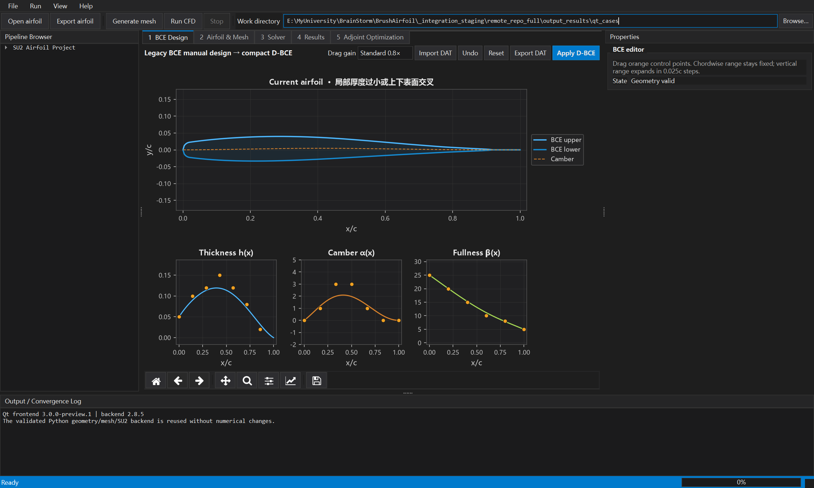
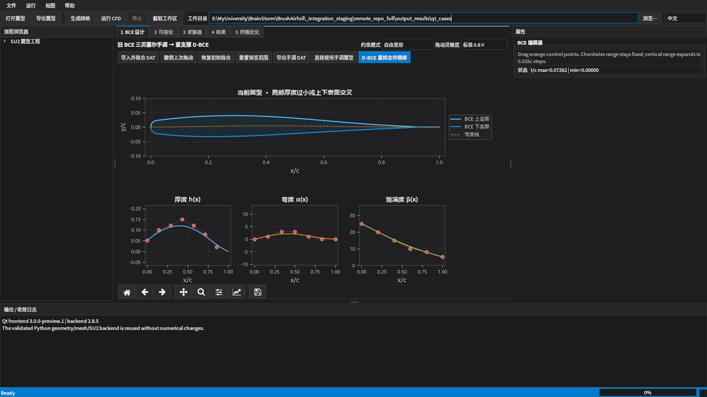
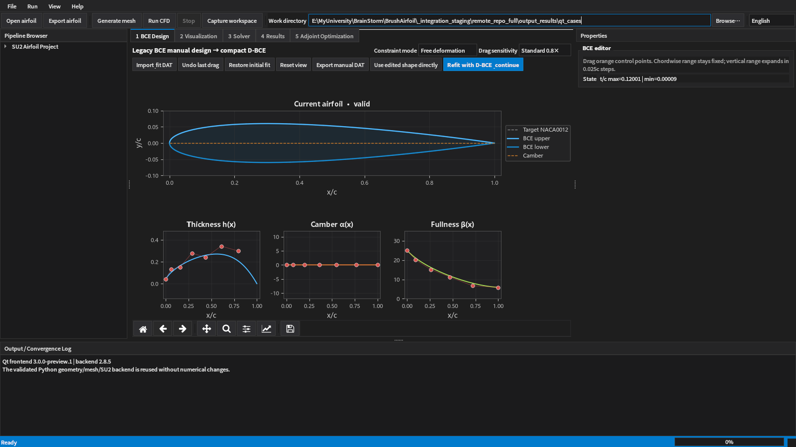

# SU2 Airfoil Studio

**旧 BCE 交互设计 · 网格分辨率约束 D-BCE · CST/D-BCE 接力 · C-H 全四边形网格 · SU2 正问题与离散伴随优化**
**Legacy BCE interaction · mesh-resolved D-BCE · CST/D-BCE relay · all-quad C-H mesh · SU2 direct and discrete-adjoint optimization**

[](https://github.com/Phiphi007/SU2-Airfoil-Studio/actions/workflows/tests.yml)
[](LICENSE)



## 软件是什么 / What this application is

SU2 Airfoil Studio 是一个 Windows 二维翼型设计、网格、CFD 后处理和离散伴随优化桌面程序。它采用接近 ParaView/Fluent 的 PySide6 + VTK 工业界面，保留原始 BCE 的三条 Bézier 控制曲线用于手动拖点设计，再将几何无跳变地交给新的 D-BCE、CST、混合或 CST→D-BCE 接力优化。后台任务通过进度条、日志和收敛图显示，不反复弹出控制台窗口。

SU2 Airfoil Studio is a Windows desktop application for 2-D airfoil design, meshing, CFD post-processing and discrete-adjoint optimization. Its PySide6 + VTK workspace follows the compact industrial interaction model of ParaView and Fluent. The original three-curve BCE editor remains available for control-point design; the resulting geometry is handed without a shape jump to D-BCE, CST, hybrid or CST-to-D-BCE relay optimization. Background tasks report progress, logs and convergence without repeatedly opening console windows.

## 已实算的结果 / Measured end-to-end result

2026-11-23 使用 SU2 8.5.0 对 NACA0012 完成了严格固定升力全流程：先把基准继续 2400 步直至气动力窗口稳定，再测局部极曲线，运行 DRAG 与 LIFT 离散伴随、DOT、4 变量 D-BCE、SU2_DEF 和三次攻角配平。工况为 Mach 0.15、Re=3×10⁶，目标 `CL=0.21585257`。

On 2026-11-23, a strict fixed-lift NACA0012 workflow was completed with SU2 8.5.0. The baseline was continued for 2400 iterations until its force window stabilized, followed by local-polar measurements, DRAG and LIFT discrete adjoints, DOT, four-variable D-BCE, SU2_DEF and three AoA trim solves. Conditions were Mach 0.15 and Re=3×10⁶ with `CLtarget=0.21585257`.

| 指标 / Metric | 基线 / Baseline | 优化后 / Optimized | 变化 / Change |
|---|---:|---:|---:|
| CD | 0.02112409 | 0.02099670 | **−0.6031%** |
| CL | 0.21585257 | 0.21584208 | −0.00486% |
| 绝对 CL 误差 / Absolute CL error | — | 1.0485×10⁻⁵ | 通过 / pass |
| CL/CD | 10.21831 | 10.27981 | **+0.6018%** |
| 密度残差 log10 / Density residual | −6.7034 | −7.7034 | 更低 / lower |
| 优化时间（校准后）/ Optimization after calibration | — | **544.58 s** | 实测 / measured |
| 全流程 / Baseline + polar + optimization | — | **856.04 s** | 实测 / measured |


完整配置、原始 SU2 历史、优化前后 DAT、复现脚本及“未收敛基准曾造成虚假 3.078% 降阻”的审计见[双语操作案例](examples/case_studies/naca0012_dbce_fixed_lift/CASE_STUDY.md)。本结果证明这一工况下约 0.60% 的同升力改进，不代表 D-BCE 在所有目标和工况中优于 CST。

See the [bilingual case study](examples/case_studies/naca0012_dbce_fixed_lift/CASE_STUDY.md) for the configuration, raw histories, DAT files, reproduction script and the audit showing why an unconverged baseline once created a false 3.078% gain. The measured fixed-lift improvement is about 0.60% for this condition, not a universal claim that D-BCE outperforms CST.

## 每个功能怎样使用 / How to use every module

### 1. 工作目录与翼型 / Workspace and airfoil

启动后首先选择工作目录。可以使用内置 NACA 翼型、导入 Selig 顺序 `.dat`，或直接打开已有 `.su2` 网格。所有生成文件都进入当前算例目录，源 DAT 不会被覆盖。

Select a working directory first. Start from a built-in NACA section, import a Selig-order `.dat`, or open an existing `.su2` mesh. Generated files are written into the current case directory and the source DAT is never overwritten.

### 2. 旧 BCE 手调 / Legacy BCE manual design

旧 BCE 页面默认从解析尖后缘 NACA0012 开始，并完整保留三条函数 `h(x)`、`α(x)`、`β(x)` 的红色 Bézier 控制点。BCE 仅施加相对于拟合基线的增量，因此启动和复位时的几何严格保持 NACA0012，而不会被拟合误差替换。界面提供“自由变形、锁定厚度、锁定弯度”三种约束模式；锁定厚度时保持半厚度场不变，锁定弯度时保持中弧线不变。精细/标准/快速拖动灵敏度、撤销、恢复、固定预览范围和无效几何拦截均可用。手调结果可以直接送入网格，也可以经 D-BCE 紧支撑重拟合后继续。

The legacy BCE page starts from an analytic sharp-trailing-edge NACA0012 and retains the red Bézier control points for `h(x)`, `α(x)` and `β(x)`. BCE contributes increments relative to its fitted baseline, so startup and reset preserve the exact NACA0012 instead of replacing it with the fit error. Free, Lock thickness and Lock camber modes are available: the latter two preserve the half-thickness field or mean line. Fine/standard/fast drag gain, undo, restore, stable view limits and invalid-geometry blocking are included. Use the edited shape directly for meshing or refit it with compact D-BCE before continuing.

| 中文 / Chinese | English |
|---|---|
|  |  |

### 3. D-BCE 交接与局部笔刷 / D-BCE handoff and local brushes

交接以手调翼型作为精确基准，紧支撑笔刷只定义后续可优化方向，不重新替换手调曲线。零手调时误差为机器零；有手调时采用弯度/半厚度分解和曲率正则拟合。新版优化字典还要求每个笔刷具有最小半宽并覆盖足够多 CFD 壁面节点，避免“数学上光滑、离散后锯齿”。

The manual geometry becomes the exact downstream baseline; compact brushes define optimization directions instead of replacing the edited curve. A zero-edit handoff is exact, while edited shapes use camber/half-thickness decomposition and curvature-regularized fitting. The revised optimization dictionary also enforces minimum brush width and a minimum number of CFD wall nodes, preventing a mathematically smooth brush from becoming faceted after discretization.


### 4. 翼型预处理与网格 / Geometry preparation and mesh

设置每侧采样点、全局加密系数和流场域缩放。全局加密支持粗网格流程检查，也支持更密的验证网格；界面实时估算总网格量。网格视图采用固定二维相机，只允许缩放和平移，不提供会破坏二维检查方向的旋转。生成网格后按钮变灰；翼型或网格参数改变时按钮会高亮提示重新生成。生成后检查前缘点数、壁面切向间距、首层高度、径向增长率、块接口、最小 Jacobian 和最大纵横比。

Set points per surface, global refinement and farfield scale. Global refinement spans coarse workflow checks through denser validation meshes, and the estimated cell count is shown before generation. The mesh view uses a fixed 2-D camera with zoom and pan only. Its update button is disabled when the mesh matches the current geometry/settings and highlighted after either changes. Inspect leading-edge resolution, tangential spacing, first-layer height, radial growth, block interfaces, minimum Jacobian and maximum aspect ratio in the embedded VTK view.

| 全场 / Full domain | 前缘 / Leading edge |
|---|---|
|  |  |

已有 Pointwise/Gmsh `.su2` 网格可以直接导入。边界名称从网格读取；求解前仍应确认翼型壁面和远场 marker 与配置一致。

Existing Pointwise or Gmsh `.su2` meshes can be imported directly. Boundary names are read from the mesh; verify that wall and farfield markers match the solver configuration.

### 5. 求解设置与计算监视 / Solver setup and monitoring

输入 Mach、Reynolds、攻角、湍流模型、CFL、迭代数和收敛门槛。点击开始后，日志与实时残差/CL/CD 在同一页面更新；可以暂停/继续、立即结束，或等待下一保存周期完成后结束。保存周期模式会确认流场/重启文件已经稳定落盘，等待时仍可改为立即结束。程序不会因为进程正常退出就自动宣称收敛，还会检查最终残差和末段气动力窗口。

Enter Mach, Reynolds number, angle of attack, turbulence model, CFL, iterations and convergence thresholds. Logs and live residual/CL/CD plots update on one page. Pause/resume the actual SU2 process, stop immediately, or stop after the next saved-output cycle has completed and its flow/restart files are stable. Immediate stop remains available while a checkpoint stop is pending. A normal process exit is not automatically labeled converged: final residual and late force windows are checked as well.

| 中文 / Chinese | English |
|---|---|
|  |  |

### 6. 云图、压力与报告 / Contours, pressure and report

云图 VTK 视图位于“结果”页，不再占用网格页。它可显示 Mach、Pressure、Cp 等变量，支持 Jet、Turbo、Viridis、Plasma、Coolwarm、灰度六种配色，自动色阶或手动最小/最大值，以及缩放、平移和全域重置。可以打开翼型轴线与攻角弧线，并在正上方、左上角或右上角显示翼型名称、Mach、Re、攻角等注释；参数文字可切换白色或黑色以适配明暗背景。压力分布、残差、气动力、Y+、Cf 和几何检查可导出到气动报告。

The VTK contour view lives in Results rather than replacing the mesh view. It displays Mach, pressure, Cp and other arrays with Jet, Turbo, Viridis, Plasma, Coolwarm or grayscale maps, automatic/manual limits, zoom, pan and full-domain reset. Enable the chord axis and AoA arc, place metadata at top-center, top-left or top-right, and switch its text between white and black for contrast. Pressure distribution, residuals, forces, Y+, Cf and geometry checks can be exported to the aerodynamic report.


### 7. 伴随优化 / Discrete-adjoint optimization

开始优化前必须先得到可信基线。可选择：

Before optimization, establish a trustworthy baseline. Available methods are:

- **CST**：低维全局厚度/弯度变化，适合初始搜索。Low-dimensional global thickness/camber changes for initial exploration.
- **D-BCE**：自适应选择少量局部笔刷，适合好翼型微调。Sparse adaptive local brushes for refinement of an already reasonable shape.
- **Hybrid / 混合**：同一步组合 CST 和 D-BCE，表达能力高但变量耦合更强。Combines CST and D-BCE in one step; expressive but more coupled.
- **CST → D-BCE relay / 接力**：先做全局搜索，再解释剩余局部梯度，通常是推荐起点。Global search first, then local residual-gradient refinement; usually the recommended start.

设置固定攻角或固定升力目标、弯度/厚度/联合模式、变量数、最大位移、最小厚度、攻角边界、信赖域、伴随迭代和 CFL。流程为：当前正问题 → SU2_CFD_AD → SU2_DOT_AD → QR/尺度预条件 → 稀疏方向 → 几何约束 → SU2_DEF → 新正问题 → 接受或缩短信赖域。

Configure fixed-AoA or fixed-lift objective, camber/thickness/combined mode, variable count, displacement and thickness limits, AoA bounds, trust region, adjoint iterations and CFL. The loop is current direct state → SU2_CFD_AD → SU2_DOT_AD → QR/scaling → sparse direction → geometry checks → SU2_DEF → corrected direct solve → accept or shrink.

| 中文 / Chinese | English |
|---|---|
|  |  |

优化结束后查看实际/预测比、伴随收敛、每阶段耗时、前后翼型和约束裕度。可以导出接受的 `.dat`，也可以丢弃而不修改源翼型。

After optimization, inspect actual/predicted ratio, adjoint convergence, stage timing, before/after geometry and constraint margins. Export the accepted `.dat`, or discard it without modifying the source airfoil.

## 旧 BCE 与新 D-BCE 数学 / Legacy BCE and revised D-BCE mathematics

### 原始 BCE / Legacy BCE

对 $q\in\{h,\alpha,\beta\}$，控制函数是 Bézier 曲线：

For $q\in\{h,\alpha,\beta\}$, each control function is a Bézier curve:

$$
q(t)=\sum_{i=0}^{n}\binom{n}{i}(1-t)^{n-i}t^i q_i.
$$

由 $h,\alpha,\beta$ 构造局部椭圆族。令

A family of local ellipses is constructed from $h,\alpha,\beta$. Define

$$
D=\cos^2\beta-\sin^2\alpha,
\qquad y_c=\frac{h\sin\alpha\cos\alpha}{D},
$$

$$
r_y=\frac{h\sin\beta\cos\beta}{D},
\qquad r_x=\left|\frac{h\sin\beta}{\sqrt D}\right|.
$$

每个中心 $X$ 的上下弧为

The upper and lower arcs centered at $X$ are

$$
y_\pm(x;X)=y_c\pm r_y\sqrt{1-\left(\frac{x-X}{r_x}\right)^2}.
$$

最终翼型取上包络和下包络：$y_u=\sup_X y_+$、$y_l=\inf_X y_-$。这三个控制量对人工设计很直观，但三角函数耦合、接近 $D=0$ 的敏感放大和包络控制椭圆切换，会使高维 Jacobian 条件变差。因此软件保留它作为交互式设计器，而不直接把大量旧 BCE 控制点当优化变量。

The airfoil is the upper and lower envelope: $y_u=\sup_X y_+$ and $y_l=\inf_X y_-$. These controls are intuitive for manual design, but trigonometric coupling, sensitivity growth near $D=0$ and envelope-owner switching degrade a high-dimensional Jacobian. The software therefore keeps legacy BCE as an interactive generator instead of using many raw BCE control points as optimizer variables.

### 新 D-BCE / Revised D-BCE

对中心 $c$ 与半宽 $w$，定义 $s=(x-c)/w$。当 $|s|<1$ 时：

For center $c$ and half-width $w$, let $s=(x-c)/w$. When $|s|<1$:

$$
\phi_{c,w}(x)=\exp\!\left(1-\frac{1}{1-s^2}\right).
$$

当 $|s|\ge1$ 时，$\phi_{c,w}(x)=0$。函数及任意阶导数在支撑边界均为零，因此是严格局部的 $C^\infty$ 笔刷。端点窗 $e(x)=\sqrt{x}(1-x)$ 进一步固定前后缘。

When $|s|\ge1$, $\phi_{c,w}(x)=0$. The function and every derivative vanish at the support boundary, producing a strictly local $C^\infty$ brush. The endpoint taper $e(x)=\sqrt{x}(1-x)$ further fixes leading and trailing edges.

以基准弯度 $m_0$、半厚度 $t_0$ 表示上下表面：

Write the baseline with camber $m_0$ and half-thickness $t_0$:

$$
\delta m=\sum_j a_j\phi_j,\qquad \delta t=\sum_j b_j\phi_j,
$$

$$
y_u=m_0+t_0+\delta m+\delta t,
\qquad y_l=m_0-t_0+\delta m-\delta t.
$$

弯度列 `[φ;φ]` 与厚度列 `[φ;−φ]` 天然解耦。候选字典先过滤端点、最小半宽和最少 CFD 支撑点，再按伴随梯度逐列选取；所选矩阵经列尺度归一化和 QR 正交化，信赖域控制实际位移。这样解决的是“可优化性”，不是抛弃旧 BCE 的人工直觉。

Camber columns `[φ;φ]` and thickness columns `[φ;−φ]` are naturally decoupled. The candidate dictionary is filtered by endpoint safety, minimum half-width and minimum CFD support nodes, then greedily selected against the adjoint gradient. Selected columns are scaled and QR-orthogonalized, while the trust region limits physical displacement. This improves optimizability without discarding the manual intuition of legacy BCE.

### 与 CST 的关系 / Relation to CST

| 属性 / Property | CST | D-BCE |
|---|---|---|
| 支撑 / Support | 全弦全局 / global | 严格局部 / compact |
| 典型用途 / Typical use | 初始厚度、弯度和大尺度搜索 / global search | 压力敏感区与局部微调 / local refinement |
| 维数 / Dimension | 低到中 / low-medium | 自适应稀疏 / adaptive sparse |
| 主要风险 / Main risk | 高阶全局振荡 / high-order oscillation | 过窄、欠分辨笔刷 / narrow under-resolved brushes |
| 当前稳定措施 / Stabilization | class function、低阶基 / class function, low order | 支撑点门槛、QR、信赖域 / support gate, QR, trust region |

完整推导见[数学说明](docs/MATHEMATICS.md)。Full derivation is available in [Mathematics](docs/MATHEMATICS.md).

## 安装与启动 / Installation and launch

### 源码运行 / Source run

支持 Windows 10/11 与 Python 3.11/3.12。SU2 正问题需要 `SU2_CFD.exe`；伴随优化还需要 `SU2_CFD_AD.exe`、`SU2_DOT_AD.exe`、`SU2_DEF.exe` 以及对应 MinGW 运行库。

Windows 10/11 and Python 3.11/3.12 are supported. Direct CFD requires `SU2_CFD.exe`; adjoint optimization additionally requires `SU2_CFD_AD.exe`, `SU2_DOT_AD.exe`, `SU2_DEF.exe` and their MinGW runtime libraries.

```powershell
.\Setup_Windows.bat
.\Launch_SU2_Airfoil_Qt.bat
```

或手动运行 / Or run manually:

```powershell
py -3.12 -m venv .venv
.\.venv\Scripts\python.exe -m pip install -r requirements.txt
.\.venv\Scripts\python.exe -m qt_app.main
```

### 测试 / Tests

Tk/Matplotlib 核心回归与 Qt/VTK 前端回归分进程运行，避免 Windows 原生 GUI 运行时相互影响。

Core Tk/Matplotlib regressions and Qt/VTK front-end regressions run in separate processes to isolate native Windows GUI runtimes.

```powershell
.\.venv\Scripts\python.exe -m pip install -r requirements-dev.txt
.\.venv\Scripts\python.exe -m unittest discover -s tests -v
.\.venv\Scripts\python.exe -m pytest tests/test_qt_frontend.py -v
```

## 输出文件 / Outputs

- `processed_airfoil.dat`：预处理翼型 / processed geometry.
- `mesh.su2`, `mesh.msh`, `mesh_quality.json`：网格与质量 / mesh and quality.
- `run.cfg`, `case_settings.json`：物理与可复现设置 / physics and reproducible settings.
- `history.csv`, `surface_flow.csv`, `flow.vtu`：SU2 原始结果 / raw SU2 results.
- `Aerodynamic_Report/`：气动与几何报告 / aerodynamic and geometry report.
- `optimization_history.csv`, `optimization_summary.json`：接受判据、耗时与约束 / acceptance, timing and constraints.
- `initial_airfoil.dat`, `final_airfoil.dat`, `airfoil_comparison.png`：优化前后结果 / before-and-after optimization.

## 仓库结构 / Repository map

- `qt_app/`：当前生产桌面界面 / current production desktop UI.
- `core_modules/`：几何、网格、SU2、报告、云图 / geometry, meshing, SU2, reports and contours.
- `parametric_adjoint/`：旧 BCE 交接、D-BCE/CST 与伴随优化 / legacy handoff, D-BCE/CST and adjoint optimizer.
- `examples/case_studies/`：可复现实算案例 / reproducible measured case studies.
- `tests/`：核心与界面回归 / core and UI regressions.
- `packaging/`：Qt 便携版构建 / Qt portable packaging.
- `docs/`：用户指南、数学、架构和验证 / guide, mathematics, architecture and validation.

`gui_app.py` 与少量 Tk 组件目前仅作为经过验证的数值兼容后端和回归夹具保留；用户入口是 `qt_app.main`。Legacy Tk files remain only as validated compatibility backends and regression fixtures; the user-facing entry point is `qt_app.main`.

## 工程边界 / Engineering limits

- 一次优化成功不替代网格无关性。One successful optimization does not replace grid independence.
- 固定攻角减阻不等于固定升力减阻。Fixed-AoA drag reduction is not fixed-lift drag reduction.
- 平滑显示不能修复欠分辨几何或 CFD 误差。Display smoothing cannot repair under-resolved geometry or CFD error.
- D-BCE 适合局部精修，但不保证每个问题都优于 CST。D-BCE is useful for local refinement but is not guaranteed to beat CST for every problem.
- 生产结论应覆盖多工况，并与实验或高可信参考数据比较。Production conclusions require multiple operating points and experimental or high-fidelity reference data.

更多操作细节见[用户指南](docs/USER_GUIDE.md)，验证条件见[测试报告](docs/TESTING.md)。See the [User Guide](docs/USER_GUIDE.md) and [Testing Report](docs/TESTING.md) for additional operating and validation details.

## 许可证 / License

本项目采用 [MIT License](LICENSE)。SU2、Gmsh、VTK、Qt、Noto Sans CJK 等第三方组件遵循各自许可证；发布包声明见 [THIRD_PARTY_NOTICES.md](THIRD_PARTY_NOTICES.md)。

This project is released under the [MIT License](LICENSE). SU2, Gmsh, VTK, Qt, Noto Sans CJK and other third-party components retain their own licenses; see [THIRD_PARTY_NOTICES.md](THIRD_PARTY_NOTICES.md).
