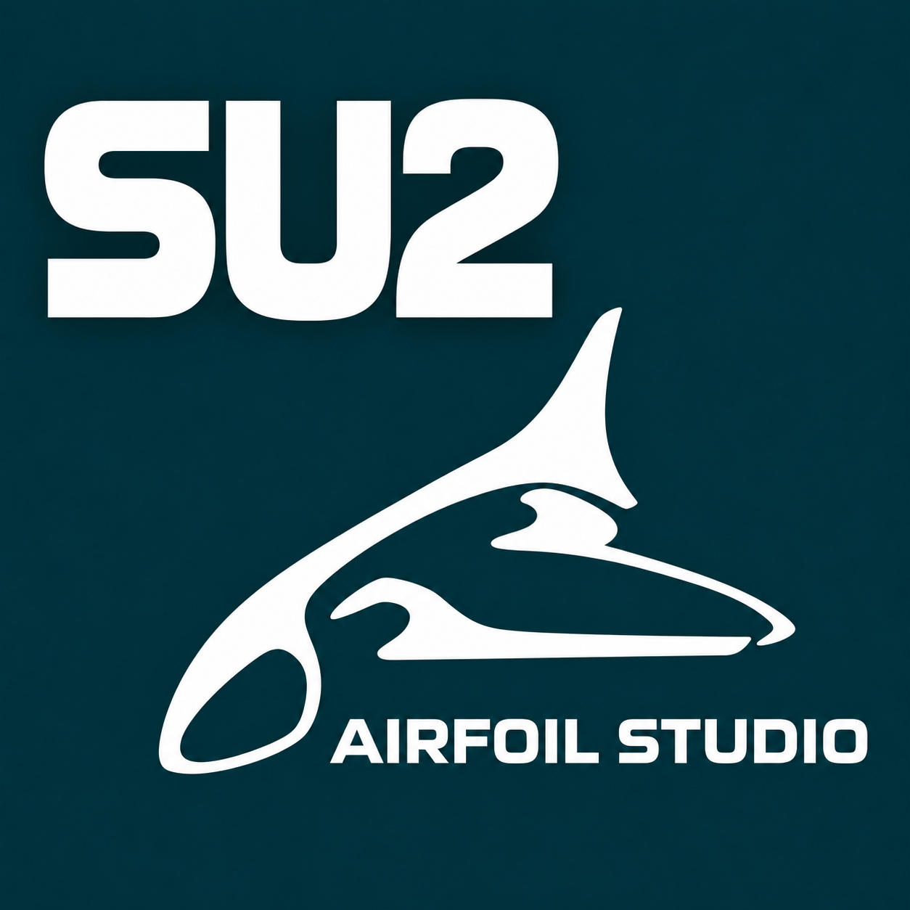
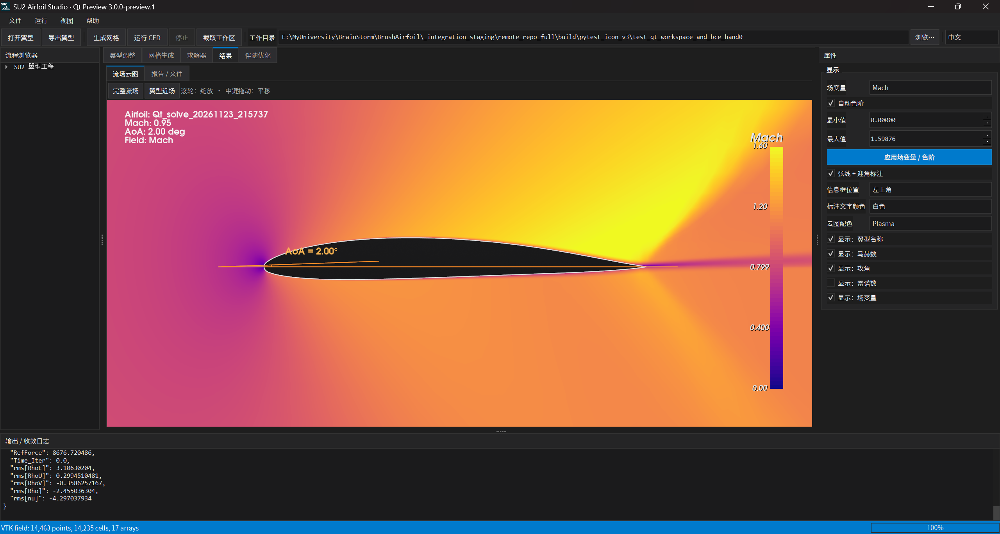
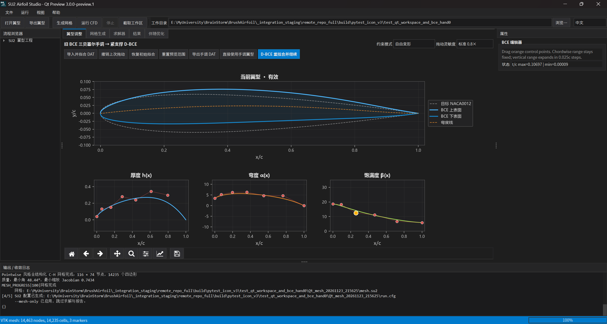
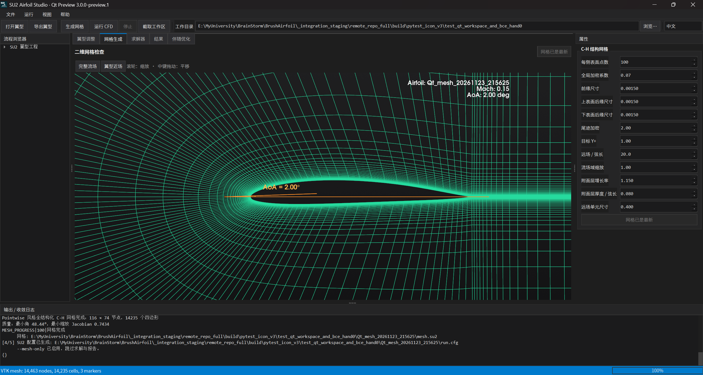
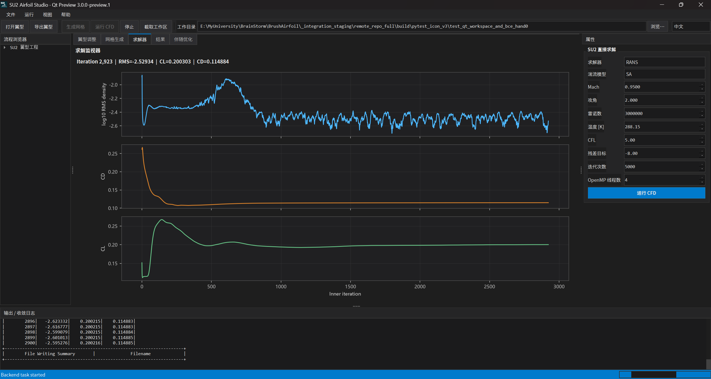
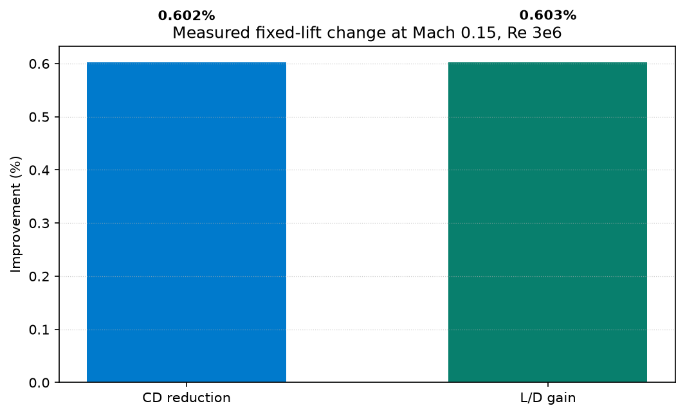

<div align="center">



# SU2 Airfoil Studio

### 二维翼型设计、结构化网格、SU2 求解与离散伴随优化桌面环境

**[简体中文](README.zh-CN.md) | [English](README.en.md) | [语言主页](README.md)**

[](https://github.com/Phiphi007/SU2-Airfoil-Studio/releases/latest)
[](https://github.com/Phiphi007/SU2-Airfoil-Studio/actions/workflows/tests.yml)
[](LICENSE)

</div>



## 下载与启动

从 [GitHub Releases](https://github.com/Phiphi007/SU2-Airfoil-Studio/releases/tag/v1.0.1) 下载 `SU2_Airfoil_Studio_V1.0.1_Windows_x64.zip`，核对 SHA-256 后完整解压，运行 `SU2_Airfoil_Studio_Qt.exe`。

- 支持 Windows 10/11 x64。
- 已包含 SU2 8.5.0 正问题、离散伴随及变形工具和 Gmsh。
- 不需要安装 Python。
- 不要单独复制主 EXE；`_internal`、`solvers`、`assets` 与文档目录均属于运行时。

## 软件简介

SU2 Airfoil Studio 是面向二维翼型设计和气动优化的专业桌面程序。界面采用 PySide6 + VTK 工业深色布局，保留旧 BCE 三条 Bézier 曲线的拖点设计方式，并将几何无跳变地交给 D-BCE、CST、混合或 CST→D-BCE 接力优化。网格、求解、日志、收敛曲线和结果云图均内嵌显示，不反复弹出控制台窗口。

核心能力：

- 旧 BCE 三曲线手调、约束模式、撤销与 DAT 导出。
- 网格分辨率约束的紧支撑 D-BCE 局部笔刷。
- CST、D-BCE、混合和接力参数化。
- Pointwise 风格全四边形 C-H 结构化网格。
- SU2 正问题、实时残差/CL/CD 和两种安全结束模式。
- 可配置 VTK 云图、压力分布、气动报告和离散伴随优化。

## 界面一览

| 翼型调整 | C-H 结构化网格 |
|---|---|
|  |  |
| **实时求解监视** | **结果与云图** |
|  |  |

> 求解器截图用于展示实时监视能力；其中的跨声速试算没有满足本项目的收敛判据，不能作为验证数据。

## 实测端到端结果

2026-11-23 使用 SU2 8.5.0 完成 NACA0012 固定升力流程：基准继续求解 2400 步至气动力窗口稳定，然后计算局部极曲线、DRAG/LIFT 离散伴随、DOT、四变量 D-BCE、SU2_DEF 和三次攻角配平。工况为 Mach 0.15、Re=3×10⁶，目标 `CL=0.21585257`。

| 指标 | 基线 | 优化后 | 变化 |
|---|---:|---:|---:|
| CD | 0.02112409 | 0.02099670 | **−0.6031%** |
| CL | 0.21585257 | 0.21584208 | −0.00486% |
| 绝对 CL 误差 | — | 1.0485×10⁻⁵ | 通过 |
| CL/CD | 10.21831 | 10.27981 | **+0.6018%** |
| 密度残差 log10 | −6.7034 | −7.7034 | 更低 |
| 优化时间（校准后） | — | **544.58 s** | 实测 |
| 全流程 | — | **856.04 s** | 实测 |



完整配置、SU2 历史、优化前后 DAT、复现脚本以及“未收敛基准曾造成虚假 3.078% 降阻”的审计见[操作案例](examples/case_studies/naca0012_dbce_fixed_lift/CASE_STUDY.md)。该结果只证明当前工况约 0.60% 的同升力改进，不代表 D-BCE 在所有任务中优于 CST。

## 使用流程

### 1. 工作目录与翼型

启动后先选择工作目录。可以使用内置 NACA 翼型、导入 Selig 顺序 `.dat`，或直接打开已有 `.su2` 网格。生成文件写入当前算例目录，源 DAT 不会被覆盖。

### 2. 旧 BCE 手调

默认从解析尖后缘 NACA0012 开始，保留 `h(x)`、`α(x)`、`β(x)` 三条 Bézier 曲线的红色控制点。BCE 只施加相对于拟合基线的增量，因此启动和复位严格保持目标翼型。支持自由变形、锁定厚度、锁定弯度、拖动灵敏度、撤销、恢复、固定预览范围和无效几何拦截。结果可以直接进入网格，也可经 D-BCE 重拟合后继续。

### 3. D-BCE 交接与局部笔刷

手调翼型作为精确下游基准，紧支撑笔刷只定义后续优化方向，不替换手调曲线。字典要求最小笔刷半宽和最少 CFD 壁面支撑节点，避免连续函数离散后出现折线或高频波浪。

### 4. 网格生成

设置每侧采样点、全局加密、前后缘尺寸、Y+、附面层增长率和流场域缩放。网格视图固定为二维，只允许缩放和平移。翼型或网格参数改变时，更新按钮会高亮提示重新生成。生成后应检查前缘分辨率、第一层高度、增长率、块接口、最小 Jacobian 和最大纵横比。

已有 Pointwise/Gmsh `.su2` 网格可直接导入，但仍需核对翼面与远场 marker。

### 5. 求解器

输入 Mach、Reynolds、攻角、湍流模型、CFL、迭代数和残差目标。求解器页面同时显示日志、密度残差、CD 和 CL。

- **暂停/继续**：直接挂起或恢复 SU2 子进程。
- **立即结束**：马上终止，保留此前已经写入的文件。
- **保存周期结束**：等待下一输出周期，并确认流场/重启文件稳定写入后结束。

软件不会仅凭进程正常退出宣布收敛；必须检查最终残差和末段气动力窗口。

### 6. 结果与云图

结果页可显示 Mach、Pressure、Cp、Temperature、Y+ 等场量，支持 Jet、Turbo、Viridis、Plasma、Coolwarm 和灰度配色，以及自动/自定义色阶。可以打开弦线和攻角标注，选择信息框位置及黑白文字。

### 7. 伴随优化

先建立可信正问题基线，再选择 CST 全局搜索、D-BCE 局部微调、混合模式或 CST→D-BCE 接力。可以设置固定攻角/固定升力、弯度/厚度模式、变量数、几何约束、攻角边界、信赖域、伴随迭代和 CFL。接受的翼型可导出为 `.dat`，也可以丢弃。

## BCE 与 D-BCE 数学

### 原始 BCE

对任意 `q∈{h,α,β}`，控制函数为 Bézier 曲线：

$$
q(t)=\sum_{i=0}^{n}\binom{n}{i}(1-t)^{n-i}t^i q_i.
$$

最终翼型由局部椭圆族的上下包络形成：

$$
y_u(x)=\sup_{X}\,y_+(x;X),
\qquad
y_l(x)=\inf_{X}\,y_-(x;X).
$$

旧 BCE 对人工设计直观，但三角函数耦合、接近 `D=0` 的敏感放大以及包络控制椭圆切换会恶化高维 Jacobian 条件，因此主要保留为交互式设计器。

### D-BCE

对中心 `c` 和半宽 `w`，令 `s=(x-c)/w`：

$$
\phi_{c,w}(x)=
\begin{cases}
\exp\!\left(1-\dfrac{1}{1-s^2}\right), & |s|<1,\\
0, & |s|\ge1.
\end{cases}
$$

它是严格局部的 $C^\infty$ 笔刷。弯度列 `[φ;φ]` 与厚度列 `[φ;−φ]` 天然解耦。候选列经过支撑点门槛、尺度归一化、QR 正交化和信赖域控制。完整推导见[数学说明](docs/MATHEMATICS.md)。

## 源码运行与测试

```powershell
.\Setup_Windows.bat
.\Launch_SU2_Airfoil_Qt.bat
```

```powershell
py -3.12 -m venv .venv
.\.venv\Scripts\python.exe -m pip install -r requirements-dev.txt
.\.venv\Scripts\python.exe -m unittest discover -s tests -v
.\.venv\Scripts\python.exe -m pytest tests/test_qt_frontend.py -v
```

## 工程边界

- 一次优化成功不能替代网格无关性研究。
- 固定攻角减阻不等于固定升力减阻。
- 平滑显示不能修复欠分辨几何或 CFD 误差。

## 许可证

本项目采用 [MIT License](LICENSE)。打包组件遵循各自许可证，详见 [THIRD_PARTY_NOTICES.md](THIRD_PARTY_NOTICES.md)。

---

**[English](README.en.md) | [返回语言主页](README.md)**
