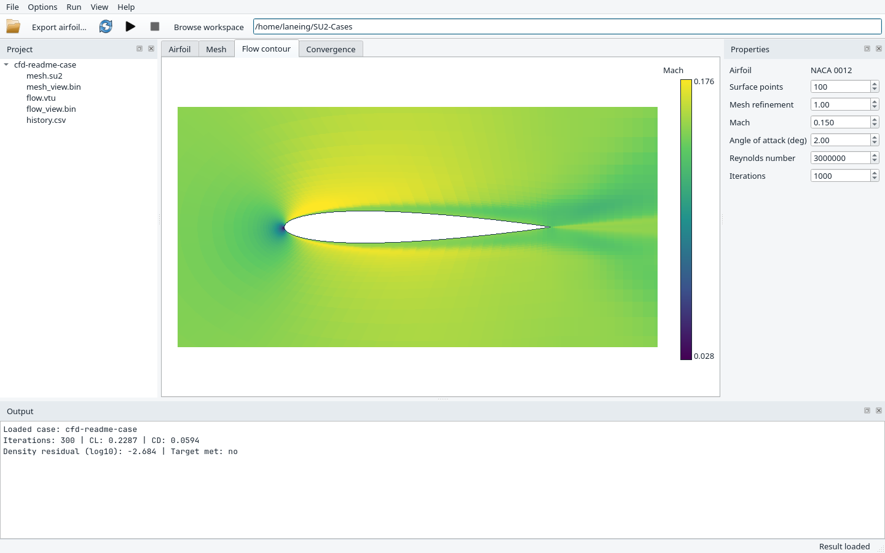

# SU2 Airfoil Studio

[English](README.md) · [繁體中文](README.zh-TW.md)

SU2 Airfoil Studio 是二维翼型设计工作台。新桌面程序采用 C++17 和 Qt 6 Widgets；数值计算由独立冻结的 Python 后端执行，配套 Gmsh 和本地编译的 SU2。界面源语言是英语，简体中文使用 Qt Linguist 翻译文件。



云图由 Qt 控件根据网格和 VTU 数据实时绘制，并非嵌入的静态图片。[网格视图](docs/screenshots/mesh-linux.png)和云图会随窗口大小适配。滚轮缩放；按住鼠标左键或中键拖动平移。示例是 NACA 0012 在马赫数 0.15、攻角 2° 下运行 300 次迭代的 Euler 集成测试。**密度残差未达到目标**，因此不能将截图视为经过验证的气动结果。

## 当前功能

C++ 桌面程序可导入和导出 DAT 翼型、生成结构化 Gmsh 网格、运行 SU2 CFD、重新打开算例、查看原生网格、马赫数云图和[收敛曲线](docs/screenshots/naca2412-convergence-linux.png)，并发送暂停、恢复、立即停止与保存后停止命令。首选项可设置语言、浅色或深色主题，以及自定义 SU2 和 Gmsh 路径。默认浅色主题；输出窗口内置 JetBrains Mono 字体。

原 Python 桌面的 BCE 交互编辑和更完整的优化、结果控制尚在迁移。C++ 菜单已有伴随优化入口，但还没有验证收敛的优化算例。请以[功能对齐清单](docs/FEATURE_PARITY.md)为验收依据；目前 C++ 桌面程序尚未完全取代原版。

## Linux 构建

需要已安装的 Qt 6 SDK（含 Widgets 与 LinguistTools）、CMake 3.16+、C++17 编译器，以及用于构建的 Python。本机已有兼容 Qt 6 SDK 时，无须重新运行 Qt Online Installer。

```sh
git submodule update --init --recursive
cmake -S . -B build/qt6 -DCMAKE_BUILD_TYPE=Release \
  -DCMAKE_PREFIX_PATH=/path/to/Qt/6.9.2/gcc_64 \
  -DSTUDIO_BOOTSTRAP_PYTHON=/path/to/python
cmake --build build/qt6 --parallel
cmake --build build/qt6 --target studio-backend-bundle
cmake --build build/qt6 --target studio-su2
```

后端目标创建构建专用虚拟环境并冻结数值程序，发布后不依赖用户的 Conda 或系统 Python。`SU2_STUDIO_PYTHON` 和 `SU2_STUDIO_ROOT` 是开发调试覆盖项。Gmsh 与 SU2 源码位于 `third_party/` 子模块，也可在首选项中指定外部安装路径。

Linux AppImage 打包选项见[交接文档](docs/HANDOFF.md)，产物为 `dist/SU2-Airfoil-Studio-x86_64.AppImage`。Windows 版计划在 Windows 本机编译为可双击运行的 EXE 目录；尚未进行 Windows 验证。

## 自动化

`portable_api.py` 提供版本化 JSON 接口，stdout 只输出一个响应，进度写入 stderr。先运行 `info`、`schema`，再为每次网格或求解提供新的输出目录。项目提供 [MCP 适配器](agent_toolkit/mcp_server.py)和 [Agent 工作流程](agent_toolkit/skills/su2-airfoil-studio/SKILL.md)。求解进程结束不等于收敛；设计结论仍需检查残差、力系数历史、近壁分辨率和网格无关性。

架构参考 [flow5](https://github.com/techwinder/flow5) 的模块化思路；项目未复制其 GPL-3.0 源码或图标。进一步阅读[重构计划](docs/REFACTOR_PLAN.md)、[界面参考决策](docs/FLOW5_REFERENCE_CHECKLIST.md)和[维护交接](docs/HANDOFF.md)。
