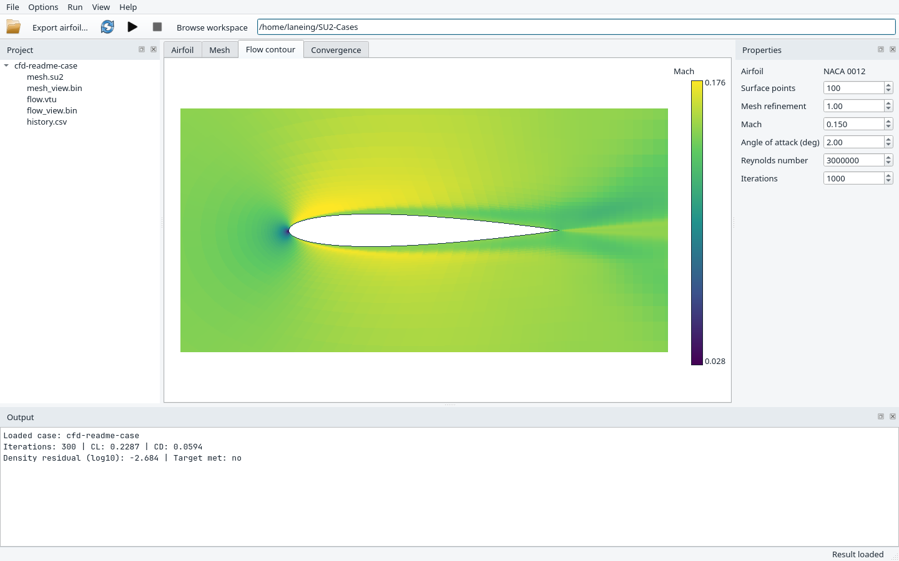

# SU2 Airfoil Studio

[English](README.md) · [简体中文](README.zh-CN.md)

SU2 Airfoil Studio 是二維翼型設計工作台。新桌面程式採用 C++17 與 Qt 6 Widgets；數值計算由獨立凍結的 Python 後端執行，並配套 Gmsh 和本機編譯的 SU2。介面原文為英文，簡體中文透過 Qt Linguist 翻譯檔提供。



雲圖由 Qt 控件根據網格與 VTU 資料即時繪製，並非嵌入的靜態圖片。[網格視圖](docs/screenshots/mesh-linux.png)和雲圖會隨視窗大小調整。滾輪縮放；按住滑鼠左鍵或中鍵拖曳平移。範例是 NACA 0012 在馬赫數 0.15、攻角 2° 下執行 300 次迭代的 Euler 整合測試。**密度殘差未達目標**，因此不能把截圖當作已驗證的氣動結果。

## 目前功能

C++ 桌面程式可匯入與匯出 DAT 翼型、產生結構化 Gmsh 網格、執行 SU2 CFD、重新開啟算例、查看原生網格、馬赫數雲圖與[收斂曲線](docs/screenshots/naca2412-convergence-linux.png)，並傳送暫停、恢復、立即停止及儲存後停止命令。偏好設定可調整語言、淺色或深色主題，以及自訂 SU2 和 Gmsh 路徑。預設為淺色主題；輸出視窗內建 JetBrains Mono 字型。

原 Python 桌面的 BCE 互動編輯及更完整的最佳化、結果控制仍在移植中。C++ 選單已有伴隨最佳化入口，但尚未驗證收斂的最佳化案例。請以[功能對齊清單](docs/FEATURE_PARITY.md)為驗收依據；目前 C++ 桌面程式尚未完全取代原版。

## Linux 建置

需要已安裝的 Qt 6 SDK（含 Widgets 與 LinguistTools）、CMake 3.16+、C++17 編譯器，以及用於建置的 Python。本機已有相容 Qt 6 SDK 時，無須重新執行 Qt Online Installer。

```sh
git submodule update --init --recursive
cmake -S . -B build/qt6 -DCMAKE_BUILD_TYPE=Release \
  -DCMAKE_PREFIX_PATH=/path/to/Qt/6.9.2/gcc_64 \
  -DSTUDIO_BOOTSTRAP_PYTHON=/path/to/python
cmake --build build/qt6 --parallel
cmake --build build/qt6 --target studio-backend-bundle
cmake --build build/qt6 --target studio-su2
```

後端目標建立專用虛擬環境並凍結數值程式，發佈後不依賴使用者的 Conda 或系統 Python。`SU2_STUDIO_PYTHON` 與 `SU2_STUDIO_ROOT` 是開發調試覆蓋項。Gmsh 和 SU2 原始碼位於 `third_party/` 子模組，也可在偏好設定中指定外部安裝路徑。

Linux AppImage 打包選項見[交接文件](docs/HANDOFF.md)，產物為 `dist/SU2-Airfoil-Studio-x86_64.AppImage`。Windows 版計畫在 Windows 本機編譯成可雙擊執行的 EXE 目錄；尚未進行 Windows 驗證。

## 自動化

`portable_api.py` 提供版本化 JSON 介面，stdout 只輸出一個回應，進度寫入 stderr。先執行 `info`、`schema`，再為每次網格或求解提供新的輸出目錄。專案提供 [MCP 轉接器](agent_toolkit/mcp_server.py)和 [Agent 工作流程](agent_toolkit/skills/su2-airfoil-studio/SKILL.md)。求解程序結束不等於收斂；設計結論仍需檢查殘差、力係數歷史、近壁解析度與網格獨立性。

架構參考 [flow5](https://github.com/techwinder/flow5) 的模組化思路；專案沒有複製其 GPL-3.0 原始碼或圖示。進一步閱讀[重構計畫](docs/REFACTOR_PLAN.md)、[介面參考決策](docs/FLOW5_REFERENCE_CHECKLIST.md)和[維護交接](docs/HANDOFF.md)。
