# SU2 Airfoil Studio 全流程界面测试 / Full UI Workflow Test

测试日期 / Test date: 2026-11-22  
平台 / Platform: Windows, Qt 6 + VTK, SU2 8.5.0 Harrier

## 结论 / Verdict

新版程序已完成从手动 BCE 变形、D-BCE 再拟合、结构网格生成、SU2 直接流求解、结果浏览到伴随优化配置的实际界面走查；中文和英文界面均可即时切换并保存工作区截图。

The new application completed a hands-on UI walkthrough covering manual BCE deformation, D-BCE refitting, structured mesh generation, an SU2 direct-flow run, result browsing, and adjoint-optimization setup. Both Chinese and English interfaces switch at runtime and can capture the complete workspace.

本次大幅变形算例的**程序流程成功，但 CFD 未收敛**。120 步后 `rms[Rho] = -3.37618`，未达到 `-5`；`CL = 0.77731`、`CD = -0.03760`，气动力仍在漂移，因此这些系数不能用于物理结论，伴随优化也没有在该无效基流上启动。

The workflow completed, but the aggressively deformed test case **did not reach CFD convergence**. After 120 iterations, `rms[Rho] = -3.37618` versus the `-5` target; `CL = 0.77731` and `CD = -0.03760` were still drifting. These coefficients are not physically validated, so adjoint optimization was intentionally not launched on this invalid base flow.

## 实测记录 / Measured Record

| 项目 / Item | 实测结果 / Observed result |
|---|---|
| 手动变形 / Manual deformation | 弯度与厚度控制点大幅拖动成功 / Large camber and thickness drags succeeded |
| D-BCE 接力 / D-BCE handoff | 20 variables, RMSE `1.503e-05`; DAT exported |
| 网格 / Mesh | `451 × 205` nodes, `320,688` quads, 3 markers |
| 网格质量 / Mesh quality | min angle `43.67°`; min scaled Jacobian `0.6888` |
| CFD 工况 / Conditions | Euler, Mach `0.15`, AoA `2°`, Re `3.0e6`, CFL `3` |
| CFD 规模 / CFD size | `321,903` points, `320,688` cells |
| CFD 耗时 / Wall time | approximately 2 min including remeshing and report generation |
| CFD 收敛 / Convergence | failed target at 120 iterations; results rejected for validation |
| 伴随 / Adjoint | configuration and executable discovery verified; run blocked by unconverged direct flow |
| 自动测试 / Automated tests | `15 passed` after the metadata regression test was added |

## 中英双语界面证据 / Bilingual UI Evidence

### 1. BCE 设计 / BCE design

| English | 中文 |
|---|---|
| 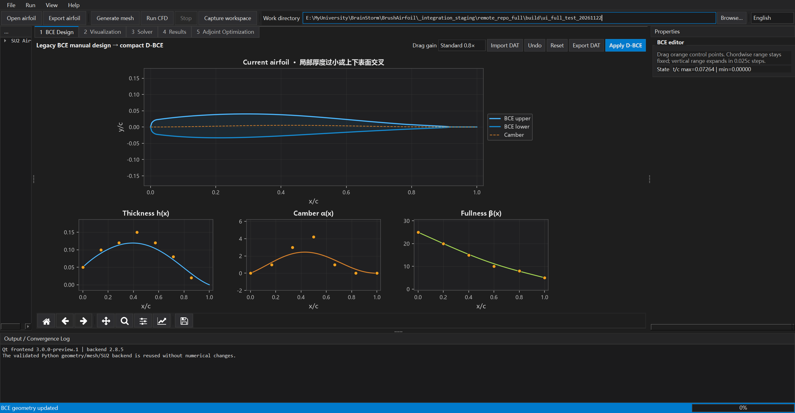 | 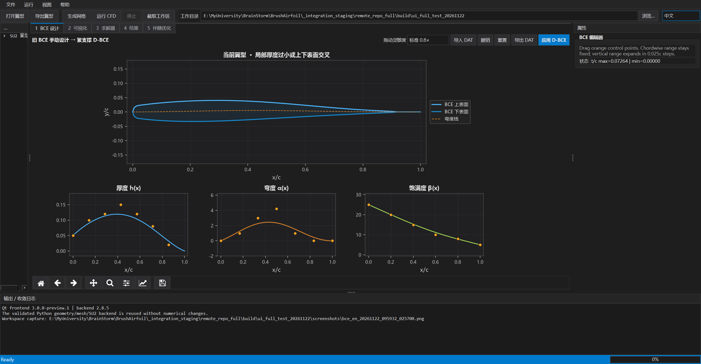 |

### 2. 内嵌网格 / Embedded mesh

| English | 中文 |
|---|---|
| 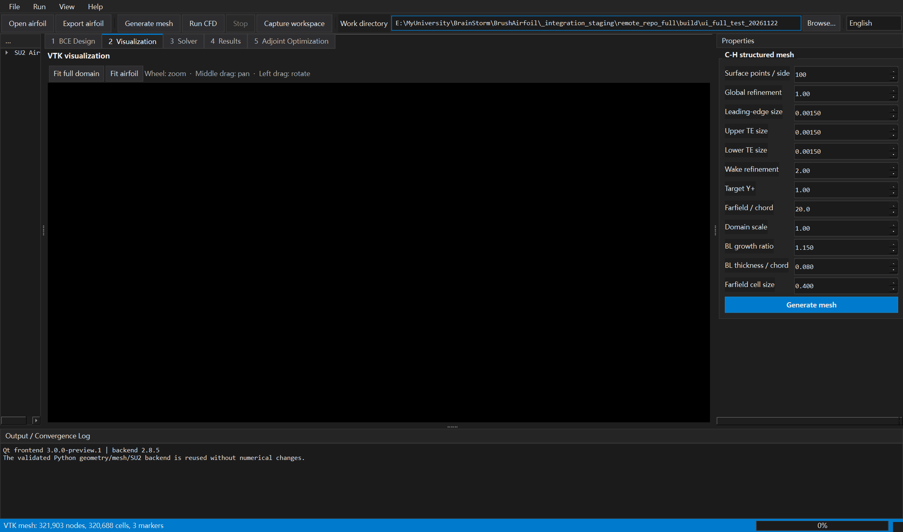 | 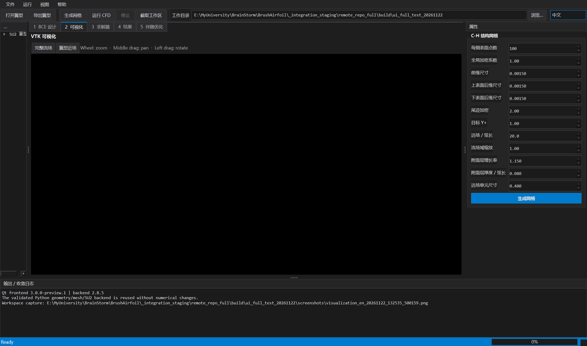 |

### 3. 求解设置 / Solver setup

| English | 中文 |
|---|---|
| 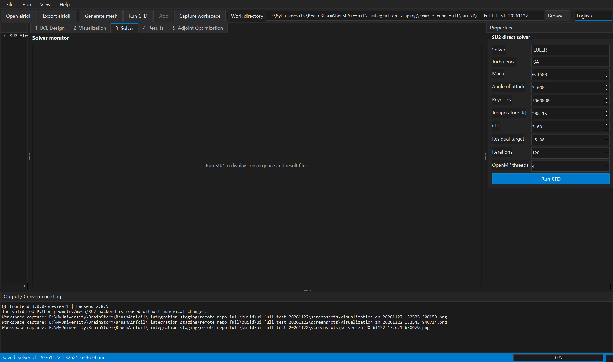 | 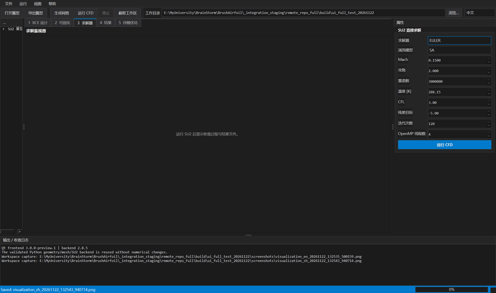 |

### 4. 流场与结果 / Flow field and results

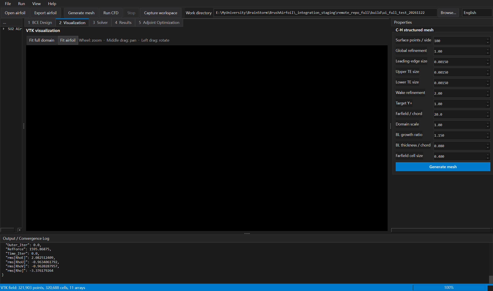

| English | 中文 |
|---|---|
| 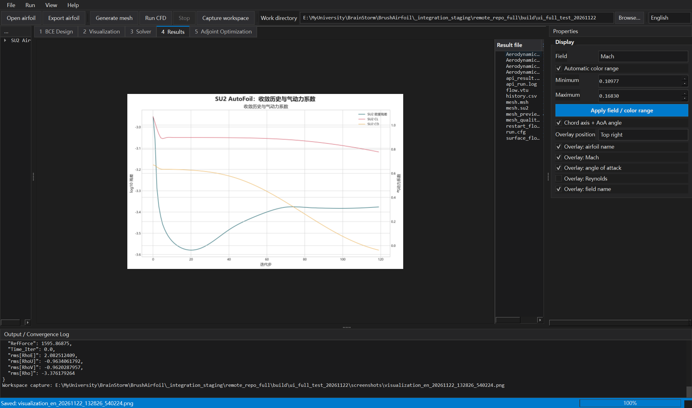 | 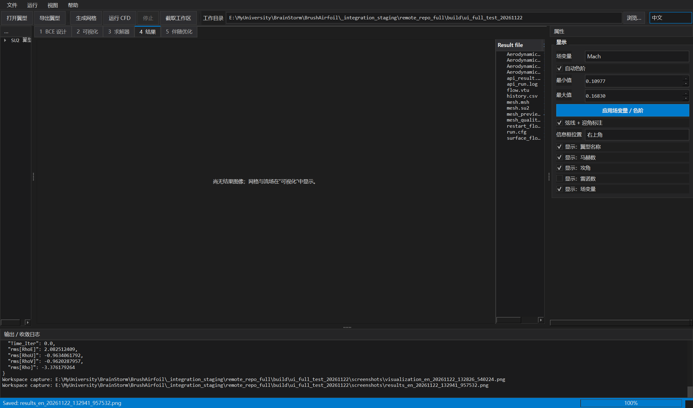 |

### 5. 伴随优化 / Adjoint optimization

| English | 中文 |
|---|---|
| 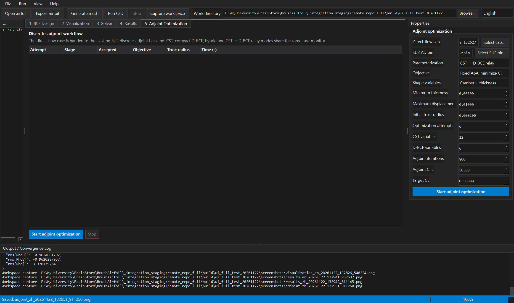 | 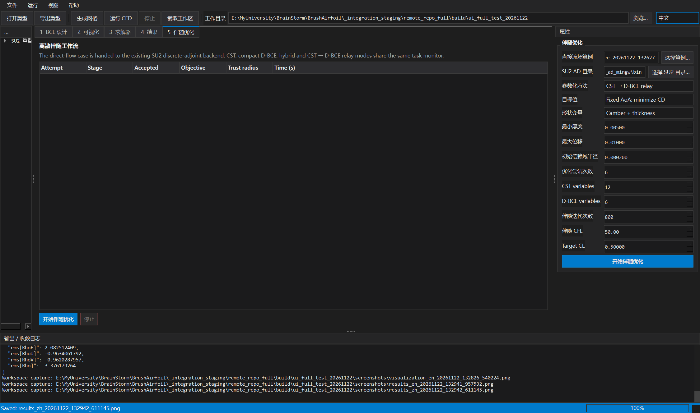 |

## 测试中修复 / Fixes Made During Testing

- 采用用户提供图形制作正式 PNG/ICO 图标，并应用于窗口和 Windows 可执行文件。  
  Created production PNG/ICO branding from the supplied artwork and applied it to the window and Windows executable.
- 增加运行时中英双语切换和 `Ctrl+Shift+P` 工作区截图。  
  Added runtime Chinese/English switching and `Ctrl+Shift+P` workspace capture.
- 修复打包入口大小写判断和错误 ICU DLL 收集。  
  Fixed frozen-entry executable dispatch and filtered a conflicting ICU DLL.
- 修复缺少 `case_settings.json` 时迎角显示为 0° 的问题；现在从 `run.cfg` 回读 Mach、AoA 和 Reynolds。  
  Fixed the erroneous 0° overlay when `case_settings.json` is absent by reading Mach, AoA and Reynolds from `run.cfg`.

## 尚需完成的数值验证 / Remaining Numerical Validation

本轮证明的是软件链路和界面集成，不是网格无关性或气动精度验证。下一阶段应先为大变形翼型建立更保守的启动策略（低 CFL、一阶启动后切二阶、更多迭代与气动力平台判据），得到可信基流后再执行离散伴随，并与实验或公开基准极曲线比较。

This run validates software integration, not grid independence or aerodynamic accuracy. The next stage should use a more conservative startup for strongly deformed airfoils (lower CFL, first-order startup followed by second order, more iterations, and force-plateau checks), establish a trustworthy base flow, and only then run the discrete adjoint and compare against experimental or public polar data.
