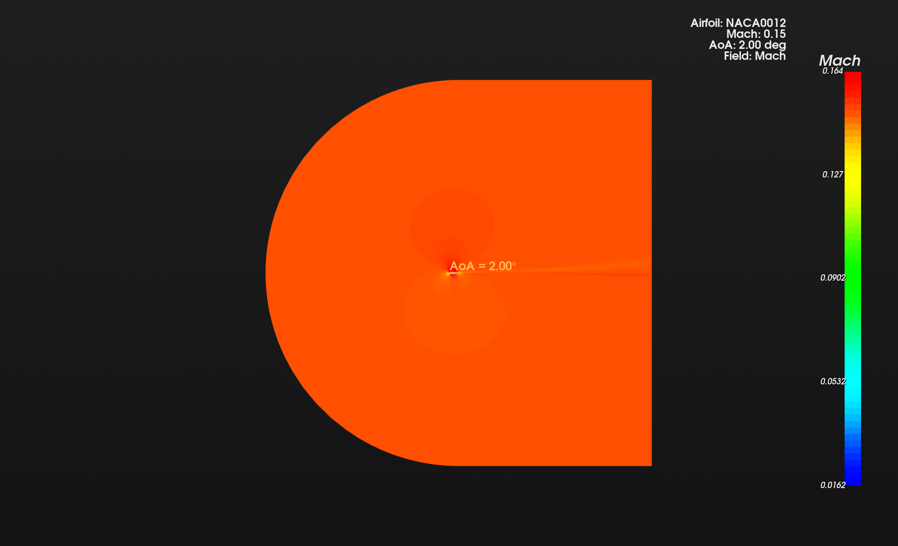
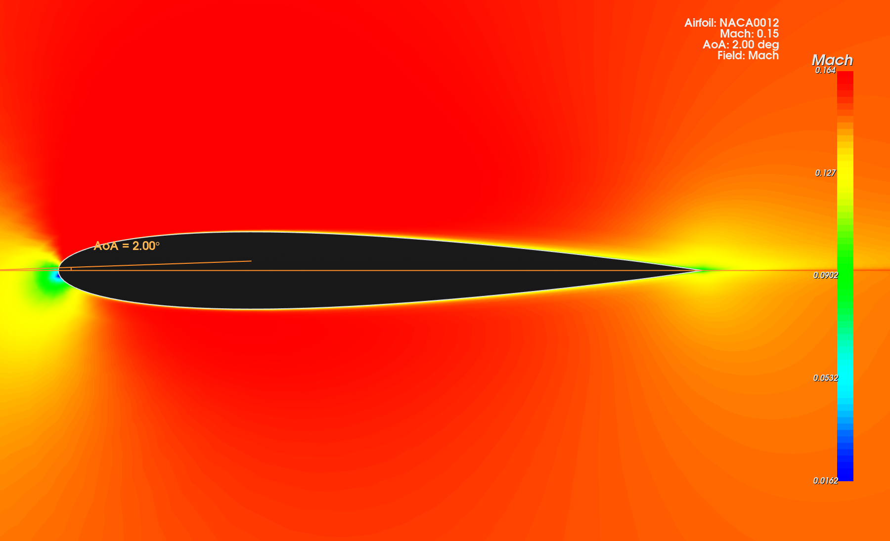
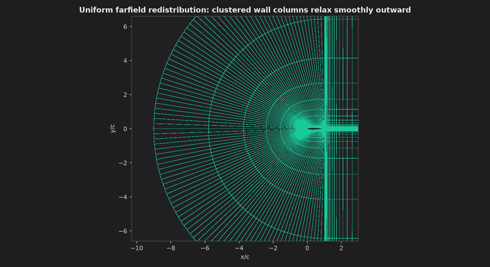

# Qt 6 desktop migration / Qt 6 桌面端迁移

## 目标 / Goal

桌面层改用 PySide6（Qt 6），采用 ParaView 风格的可停靠工作区，同时保留已经验证的 Python 数值内核。界面迁移不改变 BCE/D-BCE 数学、C-H 网格、SU2 配置或离散伴随算法。

The desktop layer is being migrated to PySide6 (Qt 6) with a ParaView-style dockable workspace while retaining the validated Python numerical backend. The migration does not change BCE/D-BCE mathematics, C-H meshing, SU2 configuration or the discrete-adjoint algorithm.

## 工作区 / Workspace

- `Pipeline Browser`：按翼型、D-BCE 交接、网格、直接求解、后处理和伴随优化组织任务。
- `Properties`：随中央页面切换参数组，避免一个页面堆满控件。
- `Output / Convergence Log`：使用 Qt 事件循环流式接收网格、SU2 和伴随输出，不弹出黑色命令窗口。
- 中央页面：BCE 交互设计、网格、求解监控、结果和伴随优化。
- 独立二维 VTK Render View：网格固定在“网格生成”页，流场云图固定在“结果”页，避免两类数据互相覆盖。
- `QSettings`：保存窗口、停靠布局和工作目录。

- `Pipeline Browser` organizes airfoil, D-BCE handoff, mesh, direct solve, post-processing and adjoint tasks.
- `Properties` follows the active central page instead of crowding every control into one form.
- `Output / Convergence Log` streams meshing, SU2 and adjoint output through the Qt event loop without console windows.
- Central pages cover BCE design, mesh, solver monitoring, results and adjoint optimization.
- A single VTK Render View lets mesh and flow data share one OpenGL context, avoiding GPU-memory and context contention between tabs.
- `QSettings` preserves the window, dock layout and working directory.

## 已连接功能 / Connected functions

| Function / 功能 | Qt status / Qt 状态 | Backend / 后端 |
|---|---|---|
| Legacy BCE control-point editing / 旧 BCE 控制点拖动 | Working / 可用 | `legacy_deformation.py` math |
| DAT import/export / DAT 导入导出 | Working / 可用 | `airfoil_processor.py`, `write_selig` |
| Compact D-BCE handoff / 紧支撑 D-BCE 交接 | Working / 可用 | `compact_dbce_refit` |
| Structured mesh / 结构网格 | Working / 可用 | JSON API + existing mesh worker |
| Direct SU2 solve / SU2 直接求解 | Working / 可用 | JSON API + `SU2_CFD` |
| Results and images / 结果与图片 | Working / 可用 | existing post-processing outputs |
| Native `.su2` mesh view / 原生网格视图 | Working / 可用 | Qt + VTK GPU wireframe |
| Native `flow.vtu` view / 原生流场视图 | Working / 可用 | Qt + VTK point fields |
| Auto/custom color limits / 自动与自定义色阶 | Working / 可用 | 0.5–99.5 percentile or explicit limits |
| Full-domain/near-airfoil camera / 全域与翼型近场相机 | Working / 可用 | VTK parallel camera + wheel zoom/pan |
| Chord/AoA annotation / 弦线与迎角标注 | Working / 可用 | case metadata + world-space overlay |
| Selectable result metadata / 可选结果信息框 | Working / 可用 | airfoil, Mach, AoA, Reynolds, field |
| White/black overlay text / 黑白信息文字 | Working / 可用 | contrast-safe VTK text actor |
| Selectable colormap / 可选云图配色 | Working / 可用 | Jet, Turbo, Viridis, Plasma, Coolwarm, gray |
| Live convergence monitor / 实时收敛监视 | Working / 可用 | residual, CD and CL from `history.csv` |
| CST/D-BCE/hybrid/relay adjoint / 伴随优化 | Working / 可用 | existing optimizer + SU2 AD |

## 云图交互与标注 / Field interaction and annotation

VTU 云图独立显示在“结果”页，网格页不会再被流场覆盖。工具条可在 `Fit full domain` 与 `Fit airfoil` 间切换，二维视图使用滚轮缩放和中键平移，不提供旋转。结果属性面板可选择六种色图、自动/自定义范围、黑/白信息文字，并独立开关弦线、迎角圆弧和各项元数据；信息框可放在正上方居中、左上角或右上角。数值读取自算例的 `case_settings.json`，任意外部 VTU 缺少元数据时不会伪造条件。

VTU contours live in Results and no longer replace the mesh viewport. The toolbar switches between `Fit full domain` and `Fit airfoil`; the 2-D camera supports wheel zoom and middle-drag pan without rotation. Results controls provide six color maps, automatic/custom limits and black/white metadata text, plus independent chord/AoA and metadata toggles. The overlay can be placed at top center, top left or top right. Values come from `case_settings.json`; no conditions are invented for external VTU files without metadata.





## 前缘—远场网格过渡 / Leading-edge to farfield transition

翼面仍按曲率和目标尺寸在前缘加密，但 C 块外边界不再沿用翼面弧长参数。新版将唯一前缘列两侧的远场圆弧分别按列索引等角分布，再由带端部方向约束的 Hermite 网格在径向平滑释放壁面聚集。这样既不牺牲前缘解析度，也不会把密集前缘射线原样延伸到远场形成扇形疏密带。

The wall remains curvature- and target-size-refined at the leading edge, but the C-block outer boundary no longer reuses the wall arc-length parameter. The revised method distributes each side of the unique leading-edge column equiangularly by column index and lets the end-constrained Hermite grid relax the wall clustering smoothly in the radial direction. This preserves leading-edge resolution without projecting dense nose rays into alternating farfield sectors.



在 0.10 倍粗网格回归中，旧映射的远场角步长最大/最小比为 `33.19`，新版上下半区均为 `1.00`；同时保持最小角 `53.40°`、最小缩放 Jacobian `0.801`，共 `11,016` 个四边形。该指标也写入 `mesh_quality.json`，便于以后自动回归。

In the 0.10× coarse-grid regression, the legacy farfield maximum/minimum angular-step ratio was `33.19`; the revised upper and lower halves are both `1.00`. The mesh simultaneously retained a `53.40°` minimum angle and `0.801` minimum scaled Jacobian with `11,016` quadrilaterals. The new metric is written to `mesh_quality.json` for future automated regression.

## 运行 / Run

```powershell
.\Setup_Windows.bat
.\Launch_SU2_Airfoil_Qt.bat
```

或在已经安装依赖的环境中运行：

Or run inside an environment with the dependencies installed:

```powershell
python -m qt_app.main
```

冻结 Qt/VTK 便携目录：

Freeze the Qt/VTK portable folder:

```powershell
python -m PyInstaller --noconfirm packaging/qt_studio.spec
```

生成目录中的主程序名为 `SU2_Airfoil_Studio_Qt.exe`；它与 `AutoFoilCLI.exe` 共用同一套后端资源。VTK 会增加便携包体积，这是获得原生 GPU 网格与流场交互的代价。

The generated desktop executable is `SU2_Airfoil_Studio_Qt.exe`, sharing backend resources with `AutoFoilCLI.exe`. VTK increases the portable bundle size; that is the trade-off for native GPU mesh and field interaction.

Qt 入口位于 `qt_app/main.py`，主窗口位于 `qt_app/main_window.py`。网格与直接求解通过 `portable_api.py` 的 JSON 协议运行；伴随优化通过单独的 Qt 进程对象运行，因此长计算不会阻塞界面。

The Qt entry point is `qt_app/main.py`, and the main window is `qt_app/main_window.py`. Meshing and direct solves use the JSON protocol in `portable_api.py`; adjoint optimization uses a separate Qt process object so long runs do not block the interface.

## 迁移策略 / Migration policy

旧 Tk 入口暂不删除。只有当 Qt 版本通过网格、直接求解、后处理、伴随优化和打包回归后，才会替换正式便携版入口。这使界面重写与数值可信度验证彼此独立。

The Tk entry point is retained temporarily. The Qt version will replace the production portable entry only after mesh, direct-solve, post-processing, adjoint and packaging regressions pass. This keeps the UI rewrite independent from numerical credibility checks.

## 当前验证 / Current verification

- Qt 无界面启动、5 个中央页面和 3 个停靠面板：通过。
- BCE DAT 导出与旧 BCE → D-BCE 交接：通过，默认翼型交接 RMSE 为 `0`，20 个紧支撑变量。
- SU2 AD 自动发现及 relay/both/6-step 配置生成：通过，四个伴随程序均存在。
- 真实算例 VTK 检验：约 1.4 MB `.su2` 网格载入 `0.72 s`，约 2.7 MB `flow.vtu` 载入 `0.08 s`；17 个节点字段均被识别。
- VTK 自动色阶、手动色阶、翼型近场定位、右侧图例和单 Render View 关闭流程：通过。
- Qt 专项自动测试包含在综合回归中。
- 参数化、配置桥接、JSON API、SU2 驱动、网格导入、余弦重采样、几何修复、Y+ 和 Qt：`42 passed, 20 subtests passed`。
- C-H 网格与 NACA 0012/0015/2412/6409 多翼型质量回归：`15 passed, 10 subtests passed`。

- Headless Qt launch, five central pages and three dock panels: passed.
- BCE DAT export and legacy BCE → D-BCE handoff: passed; the default-airfoil handoff has RMSE `0` with 20 compact-support variables.
- SU2 AD discovery and relay/both/6-step configuration generation: passed; all four adjoint executables were found.
- Real-case VTK check: a roughly 1.4 MB `.su2` mesh loaded in `0.72 s`, and a roughly 2.7 MB `flow.vtu` loaded in `0.08 s`; all 17 point fields were detected.
- VTK automatic/manual limits, near-airfoil framing, side legend and single-render-view shutdown: passed.
- Qt-specific automated tests are included in the combined regression.
- Parameterization, configuration bridge, JSON API, SU2 driver, mesh import, cosine resampling, geometry repair, Y+ and Qt: `42 passed, 20 subtests passed`.
- C-H mesh and NACA 0012/0015/2412/6409 multi-airfoil quality regression: `15 passed, 10 subtests passed`.

## Windows 便携包 / Windows portable package

`packaging/build_qt_windows.py` 会冻结 Qt/VTK 前端、校验并嵌入 `SU2_CFD`、`SU2_CFD_AD`、`SU2_DOT_AD` 和 `SU2_DEF`，随后生成 ZIP 与 SHA-256 文件。构建产物还包含 Python wheel 的原始许可文件以及完整 LGPL v3 文本。便携包无需系统级 Python、Qt、VTK 或 SU2 安装。

`packaging/build_qt_windows.py` freezes the Qt/VTK frontend, validates and bundles `SU2_CFD`, `SU2_CFD_AD`, `SU2_DOT_AD` and `SU2_DEF`, then produces a ZIP and a SHA-256 file. The build also includes original Python-wheel notices and the full LGPL v3 text. The portable package does not require system-level Python, Qt, VTK or SU2 installations.

2026-11-22 的本地预览包为 `226.2 MiB`；SHA-256 校验、完整 LGPL v3 文本、内置 `SU2_CFD`/`SU2_CFD_AD`、冻结 GUI 启动以及冻结版 0.10× 粗网格生成均通过。冻结版粗网格生成 `10,692` 个四边形，最小角 `53.32°`、最小缩放 Jacobian `0.800`，上下远场角步长比均为 `1.00`。

The local preview package built on 2026-11-22 is `226.2 MiB`. SHA-256 verification, the full LGPL v3 text, bundled `SU2_CFD`/`SU2_CFD_AD`, frozen-GUI startup and a frozen 0.10× coarse-mesh run all passed. The frozen mesh produced `10,692` quadrilaterals with a `53.32°` minimum angle, `0.800` minimum scaled Jacobian and `1.00` farfield angular-step ratios on both halves.
