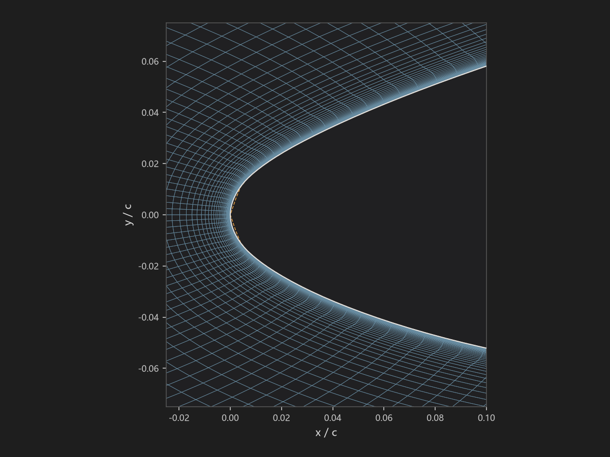
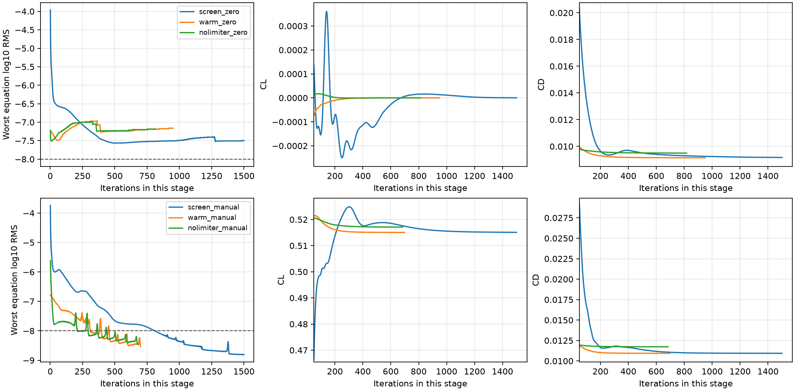

# V2.8.5 测试与验证 / Testing and Validation

本文区分“软件流程通过”“数值收敛”和“物理可信度”。三者不能互相替代。This document separates software integration, numerical convergence and physical validation; none implies the others.

## 1. 发布前验证范围 / Release validation scope

测试日期 / Test date: **2026-11-17**  
平台 / Platform: **Windows x64**  
便携依赖 / Portable dependencies: **Gmsh 4.15.2, SU2 8.5.0 OpenMP**

| 层级 / Layer | 验证 / Check | 结果 / Result |
|---|---|---|
| 几何 / Geometry | 大弯度上下表面拓扑拆分 / topology split for strong camber | Passed |
| 几何 / Geometry | 已闭合用户尖后缘保形 / preserve imported sharp TE | Passed |
| D-BCE | 零改动交接 / zero-edit handoff | Machine-zero |
| D-BCE | 强手调重拟合 / large manual-edit refit | RMSE `1.461e-4`, 20 variables |
| 单元测试 / Unit regression | 几何、D-BCE、余弦重采样、报告 / geometry, D-BCE, resampling, report | 17/17 passed |
| 网格 / Mesh | NACA6409 强弯度真实结构化网格 / real strongly cambered grid | Passed, 274.611 s |
| 冻结版 / Frozen build | GUI、Gmsh、SU2 自检 / dependency doctor | Passed |
| 正问题 / Direct CFD | 手调翼型冷启动稳态 RANS / deformed cold start | Passed force/residual window |
| 正问题 / Direct CFD | 暖启动 / warm start | Passed force/residual window |
| 伴随链 / Adjoint chain | CFD_AD → DOT_AD → DEF → CFD | Passed integration smoke test |

## 2. V2.8.5 几何稳定性修复 / Geometry stability fix

### 现象 / Symptom

大幅 BCE 手调后，报告中的翼型和上下表面压力出现振幅接近厚度的高频跳跃。After a large BCE edit, the reported geometry and upper/lower pressure curves showed high-frequency jumps comparable to local thickness.

### 根因 / Root cause

旧后处理按点相对前缘—后缘直弦的正负号分类。大弯度翼型的一段下表面也可能位于直弦上方，导致上下点交替连接。这是绘图拓扑错误，不是 SU2 网格中的真实高频形变。The old post-processor classified points by their sign relative to the straight chord. For strong camber, part of the lower surface can lie above that chord, causing alternating upper/lower connections. This was a plotting-topology error, not a high-frequency shape in the SU2 mesh.

### 修复后实测 / Measured after the fix

最近实际变形算例 `NACA0012_20261116_212718`：Latest deformed case:

| 指标 / Metric | 修复前 / Before | 修复后 / After |
|---|---:|---:|
| 上表面节点 / Upper nodes | 352, mixed | 232, continuous |
| 下表面节点 / Lower nodes | 105 | 225, continuous |
| 错分下表面点 / Misclassified lower nodes | 121 | 0 |
| 上/下索引断裂 / Branch breaks | 351 / 1 | 0 / 0 |
| 上表面最大相邻几何跳跃 / Max adjacent upper jump | thickness-scale | 0.001450c |
| 下表面最大相邻几何跳跃 / Max adjacent lower jump | thickness-scale | 0.001032c |
| 上/下最大相邻 Cp 变化 / Max adjacent Cp change | false branch jumps | 0.04891 / 0.10581 |

对同一 D-BCE 交接翼型，核心弦段曲率符号反转从旧流程的 `5/6` 次恢复到 `1/1` 次，与输入一致。For the same D-BCE handoff shape, curvature-sign changes returned from `5/6` in the old processing path to `1/1`, matching the input.

## 3. 网格验证 / Mesh validation



自动化与真实生成测试覆盖 NACA0012、0015、2412 和 6409。The automated and real-generation suite covers NACA0012, 0015, 2412 and 6409.

检查项目 / Checks:

- SU2 体单元全部为类型 9 四边形；all SU2 volume cells are type-9 quads;
- 所有有向面积为正；all oriented areas are positive;
- 尾迹上下块共形，水平尾迹扩散角为 0°；conformal upper/lower H-blocks and zero wake-line angle;
- 最小缩放 Jacobian 高于硬门槛 0.40；scaled Jacobian above 0.40;
- 默认 NACA0012 最小角约 42°；default NACA0012 minimum angle about 42°;
- 强弯度 NACA6409 最小角约 46°；NACA6409 minimum angle about 46°;
- 边界层外缘与外场首层中位高度比要求 `0.80–1.20`。median interface height ratio required within `0.80–1.20`.

NACA6409 真实网格回归耗时 **274.611 s**。该时间包含多组径向过渡候选的质量搜索，不代表所有翼型的固定耗时。The real NACA6409 regression took **274.611 s**, including quality search over radial-transition candidates.

## 4. 稳态 CFD 收敛 / Steady CFD convergence



代表性手调翼型采用 1500 步低速稳态 RANS 配置。A representative manually deformed airfoil used a 1500-iteration low-speed steady RANS setup.

| 运行 / Run | 迭代 / Iterations | 实际时间 / Wall time | 最终 CL | 最终 CD | 尾窗 CL 极差 | 尾窗 CD 极差 | 判定 / Verdict |
|---|---:|---:|---:|---:|---:|---:|---|
| 冷启动手调翼型 / cold manual | 1500 | 1225.77 s | 0.5150975 | 0.0109406 | `7.65e-5` | `3.13e-6` | Passed |
| 暖启动手调翼型 / warm manual | 698 | 940.70 s | 0.5150660 | 0.0109391 | `2.50e-5` | `3.22e-6` | Passed |

暖启动最终残差：`rms[Rho]=-9.873`, `rms[RhoU]=-8.525`, `rms[RhoV]=-9.274`, `rms[RhoE]=-9.226`, `rms[nu]=-11.363`。Warm-start final residuals are listed here to make the convergence claim auditable.

并非所有尝试都通过严格尾窗。例如零攻角筛选算例尽管 CL 已稳定，CD 尾窗约 `1.44e-5`，略高于 `1e-5` 门槛，因此记录为未通过而不是隐藏。Not every trial passed the strict window. A zero-angle screening case had stable lift but a drag range of about `1.44e-5`, just above the `1e-5` limit, and is explicitly recorded as failed.

## 5. 离散伴随集成 / Discrete-adjoint integration

记录的冻结版集成烟雾测试执行：The recorded frozen integration smoke test executed:

```text
SU2_CFD_AD (drag/lift) -> SU2_DOT_AD -> parameter direction
-> SU2_DEF -> trial SU2_CFD -> fixed-lift correction -> acceptance
```

该测试总耗时 **106.162 s**，记录的固定升力阻力从 `0.0113959` 变为 `0.0101697`，最终 `CL=0.3722085`，接受比 `ρ=0.9031`，试步被接受。The recorded chain took **106.162 s**; fixed-lift drag changed from `0.0113959` to `0.0101697`, final `CL=0.3722085`, with `ρ=0.9031`, so the trial was accepted.

这是流程集成测试，不是 D-BCE 相对 CST 的普适性能证明。This is an integration smoke test, not universal evidence that D-BCE outperforms CST.

## 6. 参数化回归 / Parameterization regression

### 收敛基准上的固定升力实算 / Fixed-lift run on a converged baseline

2026-11-23 的 NACA0012 案例先在原重启动上追加 2400 步，得到 `CL=0.21585257`、`CD=0.02112409`；随后以 `|ΔCL|≤2e-5` 为约束运行 DRAG/LIFT 离散伴随和 4 变量 D-BCE。接受结果为 `CL=0.21584208`、`CD=0.02099670`，绝对 CL 误差 `1.05e-5`，同升力降阻 `0.603%`，优化耗时 `544.58 s`。

The 2026-11-23 NACA0012 case first continued the original restart for 2400 iterations to `CL=0.21585257`, `CD=0.02112409`. DRAG/LIFT discrete adjoints and four-variable D-BCE were then run with `|ΔCL|≤2e-5`. The accepted result is `CL=0.21584208`, `CD=0.02099670`, absolute CL error `1.05e-5`, fixed-lift drag reduction `0.603%`, and optimization time `544.58 s`.

一次早期 800 步基准曾给出 3.078% 的表观降阻，但其末段气动力仍漂移；把原翼型继续收敛后，该收益几乎完全消失，因此旧结论已明确撤销。这一负面检查是回归流程的一部分：基准与候选必须达到相当的收敛成熟度。An earlier 800-iteration baseline produced an apparent 3.078% reduction while its forces were still drifting. Continuing the original airfoil removed almost all of that apparent gain, so the claim is explicitly invalidated. Comparable convergence maturity is now a required audit check.

当前 D-BCE 测试包括：Current D-BCE tests include:

- 紧支撑区外位移严格为零；exact zero displacement outside support;
- 优化笔刷满足最小半宽和最少 CFD 支撑节点；optimization brushes satisfy minimum width and CFD support-node gates;
- 前后缘不移动；fixed endpoints;
- 弯度模式上下表面同向；same-direction camber mode;
- 最终 DAT 为标准 Selig 顺序；valid Selig export;
- 零手调交接误差 `<1e-14`；zero-edit error `<1e-14`;
- 大幅手调重拟合 RMSE `<3e-4` 且最大误差 `<7e-4`；large-edit refit thresholds;
- 曲率粗糙度不超过目标的 1.2 倍；curvature roughness under `1.2×` target;
- GUI 拖动、撤销、导出和 D-BCE 交接。GUI drag, undo, export and handoff.

本 README 的 D-BCE 交接图使用同一测试构型实算得到：20 个变量，RMSE `1.460986e-4`。The handoff figure in the README was generated from that real test configuration: 20 variables and RMSE `1.460986e-4`.

## 7. 复现命令 / Reproduction commands

```powershell
# 全部 Python 回归 / all Python regressions
.\.venv\Scripts\python.exe -m unittest discover -s tests -v

# Qt 前端回归（独立进程，避免 Tk/Qt 运行时相互影响）/ Qt front-end regressions
.\.venv\Scripts\python.exe -m pytest tests/test_qt_frontend.py -v

# 关键几何和报告回归 / focused geometry and report suite
.\.venv\Scripts\python.exe -m unittest `
  tests.test_cosine_resampler `
  tests.test_post_analyzer `
  tests.test_surface_curve -v

# D-BCE 参数化 / D-BCE parameterization
.\.venv\Scripts\python.exe -m unittest tests.test_dbce_deformation -v

# 仅生成默认网格 / default mesh only
.\.venv\Scripts\python.exe main_pipeline.py --mesh-only --global-refinement 1.0
```

便携版发布前还应运行 `AutoFoilCLI.exe doctor` 和 `SU2_Airfoil_Studio_Qt.exe --smoke-test`。Before release, also run the portable dependency doctor and Qt GUI smoke test.

## 8. 尚未宣称的内容 / What is not claimed

- 未宣称所有 Reynolds/Mach/攻角组合都已实验验证。Not every flow condition is experimentally validated.
- 未宣称显示平滑可以修复数值误差。Display smoothing does not fix numerical error.
- 未宣称 D-BCE 在每个优化问题上都比 CST 快。D-BCE is not claimed to always beat CST.
- 未宣称一次网格通过即可替代网格无关性研究。A valid mesh does not replace grid-independence analysis.
- 未宣称烟雾测试中的气动系数可作为工程基准。Smoke-test coefficients are not engineering reference data.

## 9. 建议的后续基准 / Recommended next benchmarks

1. NACA0012、NACA2412、RAE2822 的三档网格与公开数据对比。Three-grid comparison against public data.
2. 相同结构安全约束下比较 CST、D-BCE、CST→D-BCE、约束 B 样条。Compare parameterizations under identical constraints.
3. 报告每次优化的正问题、伴随、变形、选择和总耗时。Report direct, adjoint, deformation, selection and total time.
4. 同时报告接受率、拒绝原因、最终气动性能、厚度裕度和梯度捕获率。Report acceptance, rejection causes, final performance, thickness margin and capture fraction.
5. 将气动、结构和防冰局部设计分别作为 D-BCE 的应用场景，而不是只用单一阻力任务下结论。Evaluate aerodynamic, structural and anti-icing local design separately.

## 10. 可信度声明 / Credibility statement

发布版证明的是：核心软件流程可运行，已列出的网格满足内部质量门槛，记录的代表性算例达到所述收敛判据。任何新的翼型、网格或工况都必须重新验证。The release demonstrates that the core workflow runs, the listed meshes pass internal quality gates, and the recorded cases satisfy the stated convergence criteria. Every new airfoil, mesh and operating point requires fresh validation.
