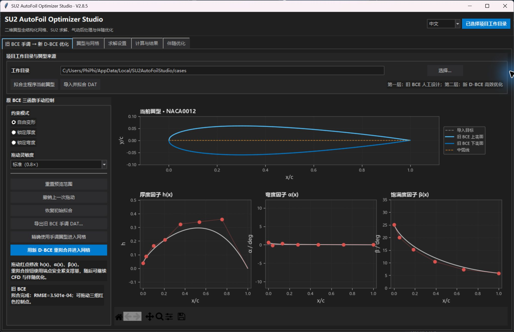
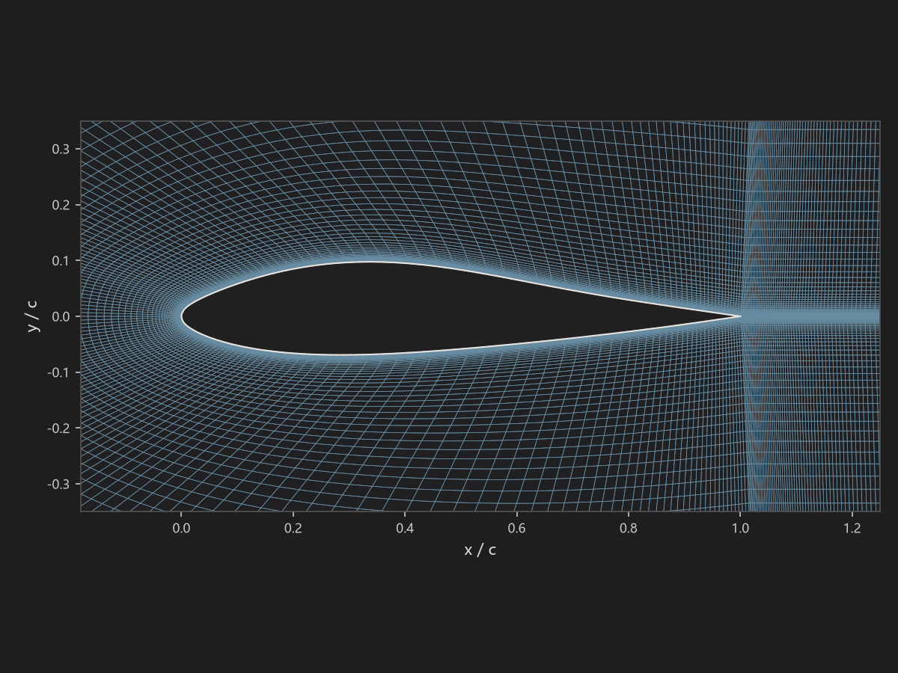
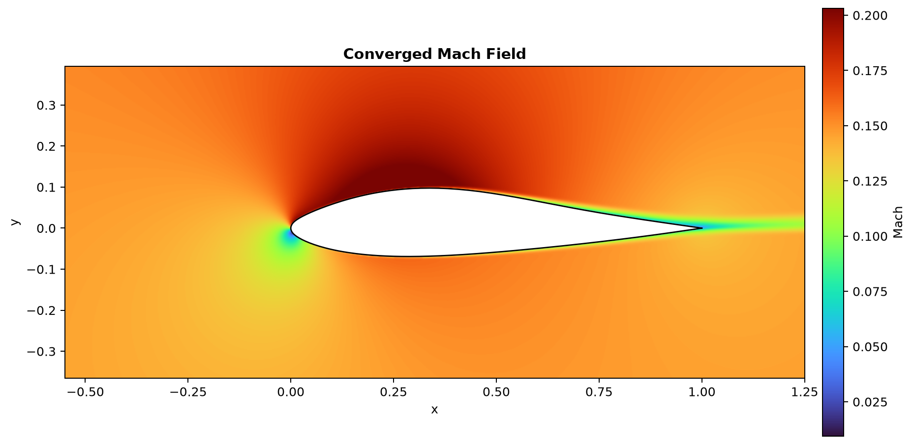

# SU2 Airfoil Studio 使用教程 / User Guide

本文对应 V2.8.5 Windows 版，按“设计 → 网格 → 设置 → 求解 → 优化 → 导出”的真实顺序说明。This guide follows the actual V2.8.5 Windows workflow: design, mesh, configure, solve, optimize and export.

## 1. 安装与首次启动 / Installation and first launch

### 便携版 / Portable build

1. 下载并完整解压 ZIP。Download and fully extract the ZIP.
2. 双击 `SU2_Airfoil_Studio_Qt.exe`。Launch the executable.
3. 软件顶部首先选择一个空的工作目录。Choose an empty working directory at the top of the window.
4. 右上角可切换“中文 / English”；切换不影响已有数据。Use the upper-right language selector; it does not alter project data.

不要从 ZIP 内直接运行，也不要单独移动 EXE，因为 `_internal`、`solver_bin`、字体和 Gmsh 是运行时的一部分。Do not run from inside the ZIP or move the EXE alone; `_internal`, `solver_bin`, fonts and Gmsh are required.

### 源码版 / Source build

```powershell
.\Setup_Windows.bat
.\Launch_SU2_Airfoil_Qt.bat
```

源码版会在 `.venv` 中安装 NumPy、Matplotlib、PySide6、VTK 与 Gmsh。确保 `SU2_CFD.exe`、`SU2_CFD_AD.exe`、`SU2_DOT_AD.exe` 与 `SU2_DEF.exe` 位于所选 SU2 目录并带有 MinGW 运行库。The source build installs NumPy, Matplotlib, PySide6, VTK and Gmsh; keep the four SU2 executables and their MinGW runtime DLLs in the selected SU2 directory.

## 2. 选择起点 / Choose a starting point

程序提供两种入口：

The application provides two starting points:

- **直接导入 / Direct import**：使用默认 NACA0012、内置 NACA 四位数或自己的 `.dat`，立即进入网格。Use a built-in or imported airfoil and proceed directly to meshing.
- **旧 BCE 手调 / Manual legacy BCE**：先通过三个函数控制翼型，再导出或交给 D-BCE。Edit the airfoil with three control functions before export or D-BCE handoff.

推荐第一次使用时选择旧 BCE 手调，以便理解三个控制量。For a first run, start with the manual BCE editor to understand the three controls.

## 3. 手动 BCE 编辑 / Manual BCE editing



主翼型视图上方显示当前轮廓、导入目标和弯度线；图例放在侧边/非遮挡位置。下方三张图分别是：The main view shows the current airfoil, imported target and camber line. The three lower plots are:

默认目标是解析尖后缘 NACA0012。旧 BCE 拟合只定义控制点和后续变形增量，因此未拖动或复位后的当前几何与 NACA0012 精确重合；导入用户 DAT 时也采用相同的“精确目标 + BCE 增量”规则。The default target is an analytic sharp-trailing-edge NACA0012. The legacy BCE fit defines only the controls and subsequent edit increments, so the untouched or reset geometry coincides exactly with NACA0012. Imported DAT files use the same exact-target-plus-BCE-increment rule.

- `h(x)`：高度/厚度尺度；控制总体厚度和局部高度。Height/thickness scale.
- `α(x)`：弯度方向；对弯度最敏感。Camber direction; the most sensitive camber control.
- `β(x)`：局部饱满度和曲率分布。Local fullness and curvature distribution.

操作步骤 / Procedure:

1. 单击控制点使其激活。Click a control point.
2. 纵向拖动；软件会限制单次灵敏度。Drag vertically; sensitivity is bounded.
3. 根据需要选择 `0.35×` 精细、`0.8×` 标准或 `1.5×` 快速。Select fine, standard or fast drag gain.
4. 选择自由变形、锁定厚度或锁定弯度。锁定厚度保持半厚度场不变；锁定弯度保持中弧线不变。Select Free, Lock thickness or Lock camber; the latter modes preserve the actual half-thickness field or mean line.
5. 若结果不理想，使用“一步撤销”；若视图扩大，使用“预览范围复位”。Use Undo or Reset view as needed.
6. 检查上下表面没有交叉，前后缘保持闭合；无效拖动会被立即撤回。Confirm that surfaces do not intersect and endpoints remain closed; invalid drags are immediately reverted.

弦向显示范围始终保持 `0≤x/c≤1`，不会因为拖动而改变弦长。纵向只按固定步长扩大，因此大变形不会被裁切，小变形也不会造成视图抖动。The chordwise view remains fixed at `0≤x/c≤1`; the vertical range expands in discrete steps only when necessary.

### 导出或交接 / Export or hand off

- **导出 DAT / Export DAT**：保留手调结果，适合外部 CAD、Pointwise 或存档。Preserves the manual shape for external tools.
- **直接使用手调翼型 / Use edited shape directly**：不重新拟合，原样进入网格。Sends the exact edited geometry to meshing without refitting.
- **D-BCE 重拟合并继续 / Refit with D-BCE & continue**：先投影到端点安全紧支撑基，再进入后续优化。Projects onto the endpoint-safe compact basis before optimization.

交接后应比较目标曲线与 D-BCE 曲线。正常情况下二者视觉重合；状态栏会给出 RMSE。After handoff, compare the target and refitted curves; they should visually overlap, with RMSE reported in the status area.

## 4. 翼型与网格 / Airfoil and mesh

### 输入翼型 / Airfoil input

支持标准 Selig 顺序：上后缘 → 前缘 → 下后缘。Supported Selig ordering is upper trailing edge → leading edge → lower trailing edge.

- `默认`：恢复内置 NACA0012。Reset to NACA0012.
- `浏览`：导入 `.dat`。Browse for a `.dat` file.
- `几何采样点数`：控制拟合和壁面离散，不等同于最终网格总量。Controls geometry sampling, not total mesh size.
- `坐标缩放系数`：同时缩放 X/Y；通常保持 `1.0`。Scales both X and Y; normally keep `1.0`.

已经闭合的用户尖后缘会保留原形。有限厚度或不闭合尾缘会拟合最后约 5% 弦长并统一到尖点。Closed sharp trailing edges are preserved; open or finite-thickness trailing edges are reconstructed near the last 5% of chord.

### 网格参数 / Mesh controls



- `全局加密系数 / Global refinement`：`0.05–10.0`。`0.05–0.25` 仅用于粗流程检查，`1.0` 为默认，`1.5–2.0` 用于网格无关性起步。Use very coarse values only for workflow checks.
- `前缘尺寸 / Leading-edge size`：越小则前缘点越密。Smaller values increase leading-edge density.
- `后缘上/下尺寸 / Upper/lower TE size`：分别控制两个逻辑后缘端。Controls the two logical trailing-edge ends.
- `尾迹加密 / Wake refinement`：提高尾迹流向与近尾缘密度。Increases wake and near-TE resolution.
- `目标 Y+ / Target Y+`：根据参考工况估算首层高度。Determines estimated first-layer spacing.
- `附面层厚度和扩张比 / BL thickness and growth`：控制径向层分布。Controls radial layers.
- `基准远场半径 / Base farfield radius` 与 `流场域缩放 / Domain scale`：二者乘积为有效远场尺寸。Their product is the effective farfield size.

参数区会先显示预计节点和四边形数量。生成时进度条依次显示几何处理、拓扑构建、质量搜索、写文件和内嵌预览。The panel estimates nodes and quads before generation; the progress bar covers geometry, topology, quality search, writing and embedded preview.

网格预览为严格二维交互：滚轮缩放、中键拖动平移，不提供旋转。网格与当前翼型/参数一致时“网格已是最新”按钮变灰；翼型或网格参数改变后按钮高亮并提示更新。The mesh preview is strictly two-dimensional: wheel zoom and middle-drag pan are available, but rotation is disabled. The update button is disabled while the mesh matches the current geometry/settings and highlighted after either changes.

### 质量判定 / Quality gate

生成后至少检查：After generation, inspect at least:

- 所有体单元为四边形；all volume cells are quads;
- 有向面积全部为正；all oriented areas are positive;
- 最小角建议不低于 `30°`；minimum angle preferably above `30°`;
- 最小缩放 Jacobian 必须不低于 `0.40`；scaled Jacobian at least `0.40`;
- 前缘过渡连续，没有极端放射状密度跳变；smooth leading-edge transition;
- 附面层外缘与外场首层高度匹配。boundary-layer and outer-grid first cells are matched.

不合格网格不会导出。遇到拒绝时，优先减小附面层厚度、清理尾段噪声或适度提高全局加密。Invalid meshes are rejected. Reduce boundary-layer thickness, clean noisy trailing-edge data or moderately increase refinement.

### 导入外部 `.su2` 网格 / Import an external `.su2` mesh

1. 在 Pointwise/Gmsh 中完成二维网格并写好标记。Create the grid and markers externally.
2. 在软件中选择“导入 SU2 网格”。Choose Import SU2 mesh.
3. 核对翼面、远场/入口/出口标记名称。Verify wall and farfield/inlet/outlet markers.
4. 使用内嵌网格视图检查方向和局部密度。Inspect orientation and density in the embedded view.
5. 进入求解设置；软件不会重写外部网格拓扑。Proceed to solver settings; topology is not regenerated.

## 5. 求解设置 / Solver settings

建议首次验证使用低速稳态 RANS 基准：For an initial check, use a low-speed steady RANS baseline:

- Mach `0.15–0.30`;
- Reynolds 数与试验/参考数据一致；match Reynolds number to the reference;
- 攻角从 `0°` 或小正值开始；start at zero or a small positive angle;
- 湍流模型保持 SA，除非有明确验证计划；use SA unless another model is validated;
- 迭代上限预留足够余量；allow enough iterations;
- 同时设置残差目标和气动力稳定窗口。Use both residual and force-window criteria.

选择“自动求解设置”时，软件会采用经过低速翼型测试的 CFL、线性求解器、多重网格和输出频率。高级用户可以打开生成的 `run.cfg` 复核。The automatic preset applies tested low-speed settings; advanced users should review the generated `run.cfg`.

## 6. 计算与结果 / Run and results

点击“开始计算”后，程序在后台依次保存几何、生成/复制网格、写配置、运行 SU2、解析结果和生成报告。The run executes in the background: geometry, mesh, configuration, SU2, parsing and reports.

- `暂停 / Pause`：挂起当前子进程。Suspends the active process.
- `继续 / Resume`：从暂停位置恢复。Resumes it.
- `终止 / Stop`：停止计算，但保留最后有效迭代。Stops while preserving the last valid iteration.

求解器页同时显示密度残差、CD 和 CL 三条实时曲线；底部日志保持可见。曲线直接增量读取 SU2 写出的 `history.csv`，不依赖控制台窗口。不要仅凭进度条或 SU2 返回码判断可信度；必须检查残差以及 CL/CD 尾窗。The Solver page shows live density-residual, CD and CL curves while the bottom log remains visible. Curves incrementally read SU2's flushed `history.csv` and do not depend on a console window. Do not judge validity from the progress bar or exit code alone; inspect residuals and the CL/CD tail window.

### 云图 / Contours



云图只显示在“结果”页，网格页保持独立。选择 Mach、Pressure、Pressure Coefficient、Temperature、Velocity、Y+ 等场量，并可切换 Jet、Turbo、Viridis、Plasma、Coolwarm 或灰度配色。`自动范围` 根据有效节点决定上下限；关闭后可输入自定义最小/最大值。右上角参数文字可选白色或黑色，并可放置在正上方、左上角或右上角。The contour lives only in Results, leaving the mesh page independent. Select a field and one of six color maps, then use automatic limits or custom bounds. Overlay text can be white or black and positioned at top-center, top-left or top-right.

界面使用高分辨率光栅化、四边形中心细分和保梯度显示平滑来改善拖动流畅度与前缘锯齿。它不修改原始数值；定量分析应读取 CSV/VTU。The UI uses rasterization, center refinement and edge-aware display smoothing. Quantitative analysis must use the raw CSV/VTU files.

## 7. 伴随优化 / Adjoint optimization

开始前先完成一个可信的正问题，并确认当前算例已自动传入优化页。Complete and validate a direct run first; the current case is then forwarded to the optimization tab.

### 参数化选择 / Parameterization choice

- **CST**：低维、全局、适合初始搜索。Low-dimensional global search.
- **D-BCE**：局部、稀疏、适合已有好翼型的微调。Sparse local refinement.
- **混合 / Hybrid**：同一步同时使用 CST 与 D-BCE；维数更高。Uses both bases in one step.
- **接力 / Relay**：先 CST 后 D-BCE；通常是推荐起点。CST first, then D-BCE; recommended default.

### 目标与约束 / Objectives and constraints

1. 输入 Mach、Reynolds、初始攻角及攻角上下限。Set flow condition and angle bounds.
2. 选择固定攻角或固定升力。Choose fixed AoA or fixed lift.
3. 选择弯度、厚度或联合变量。Choose camber, thickness or combined modes.
4. 输入最小厚度、最大单步位移、信赖域初值和最大尝试次数。Set thickness, displacement, trust radius and attempts.
5. 对 D-BCE 设置激活笔刷数、最小半宽和最少支撑节点；不要盲目增加维数。最少支撑节点用于避免光滑笔刷在稀疏 CFD 壁面上离散成锯齿。For D-BCE, set active brush count, minimum half-width and minimum support nodes; more variables are not automatically better. The support-node gate prevents a smooth brush from becoming faceted on a sparse CFD wall.

优化循环为：正问题 → 离散伴随 → 梯度投影/变量预条件 → 信赖域试步 → SU2_DEF → 新正问题 → 接受或缩小步长。The loop is direct solve → discrete adjoint → projected/preconditioned direction → trust-region trial → SU2_DEF → corrected direct solve → accept or shrink.

结束后可查看优化前后翼型对比、目标历史、每步耗时、伴随收敛和几何约束。接受的最终翼型可导出 `.dat`；若选择丢弃，则源翼型不被覆盖。Review before/after geometry, objective history, timing, adjoint convergence and constraints. Export accepted geometry to `.dat` or discard it without overwriting the source.

## 8. 结果目录 / Case directory

每个算例使用独立目录，主要文件如下：Each case uses a separate directory:

```text
case/
  processed_airfoil.dat
  mesh.su2
  mesh.msh
  mesh_quality.json
  run.cfg
  case_settings.json
  history.csv
  surface_flow.csv
  flow.vtu
  last_result.json
  Live_Convergence.png
  Contour_*.png
  Aerodynamic_Report/
```

优化目录另外保存每个尝试步的直接/伴随配置、梯度、变形网格、接受判据和总耗时。Optimization runs additionally keep direct/adjoint configurations, gradients, deformed meshes, acceptance metrics and timing for every attempt.

## 9. 常见问题 / Troubleshooting

**拖动后翼型看似震荡 / Airfoil appears oscillatory after deformation**  
先打开导出的 DAT 检查真实几何。V2.8.5 按壁面连续拓扑拆分上下表面，修复了大弯度翼型被直弦符号错误分类造成的假震荡。Inspect the exported DAT first. V2.8.5 splits surfaces by continuous wall topology, avoiding false oscillation from chord-sign classification.

**前缘云图有放射状条带 / Radial bands near the leading edge**  
先检查原始网格和原始 VTU；然后提高前缘/全局密度并做网格无关性比较。显示平滑可降低绘图伪影，但不能替代网格验证。Inspect raw mesh and VTU, refine the leading edge and perform grid-independence checks. Display smoothing is not a numerical fix.

**CL/CD 不稳定 / CL or CD does not settle**  
增加迭代，降低过激 CFL，检查网格、边界距离、攻角、模型和尾窗判据。Increase iterations, moderate CFL, and review grid, farfield, angle, model and tail-window criteria.

**伴随步被拒绝 / Adjoint step rejected**  
这是信赖域的正常行为。检查预测/实际下降比、梯度捕获率、几何条件数和厚度约束；缩小半径或减少激活笔刷。This is normal trust-region behavior. Review the reduction ratio, gradient capture, geometry condition and constraints; shrink the radius or activate fewer brushes.

## 10. 最低可信度清单 / Minimum credibility checklist

- 残差和 CL/CD 尾窗均达到要求；residual and force-window criteria pass;
- 至少三档网格比较；at least three grid levels;
- 远场尺寸敏感性检查；farfield-size sensitivity;
- Y+ 与湍流模型适用；appropriate Y+ and turbulence model;
- 读取原始 CSV/VTU，而非从平滑图片取数；use raw data, not smoothed pixels;
- 与实验、XFOIL（在适用范围内）或公开高可信数据比较；compare against experiment or trusted references;
- 优化前后使用相同物理条件和收敛门槛。Use identical physics and convergence criteria before and after optimization.
