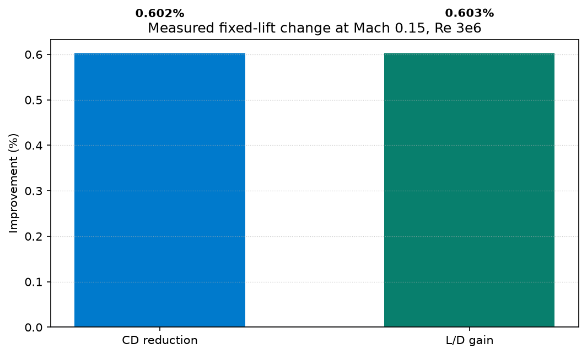
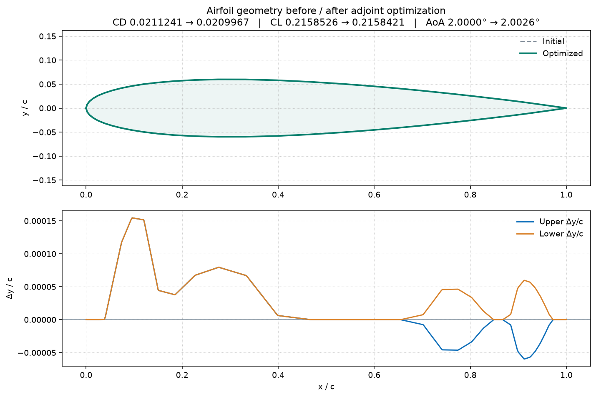
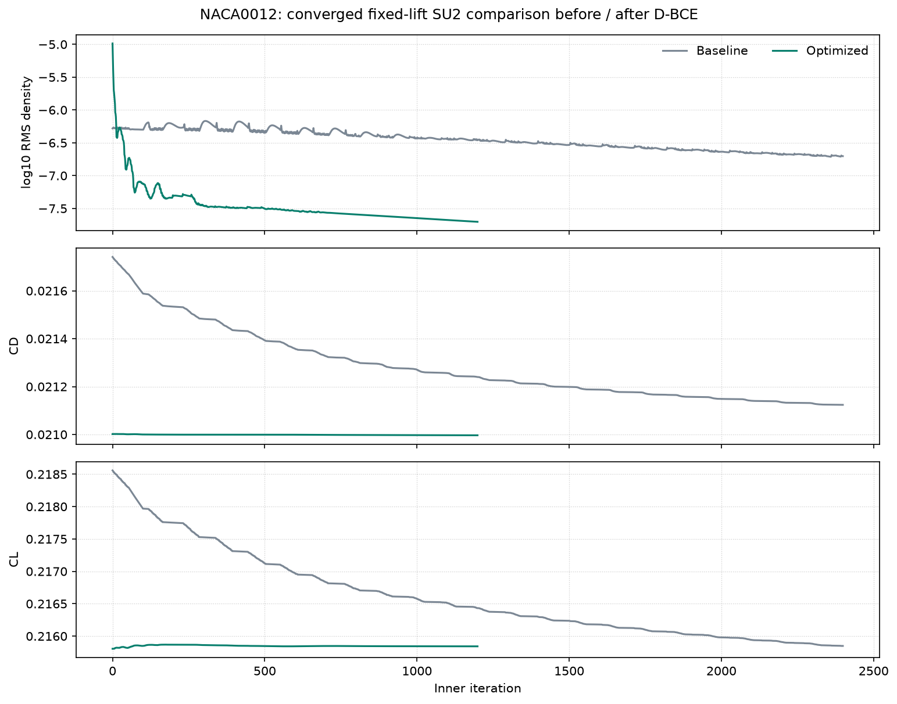

# NACA0012 D-BCE 固定升力优化案例 / NACA0012 D-BCE fixed-lift case study

## 1. 为什么重做案例 / Why this case was rebuilt

早期固定攻角案例把一个仍在漂移的 800 步基准，与更成熟的优化后解比较，曾得到 3.078% 的表观降阻。继续迭代原翼型后，基准由 `CD=0.02179610` 收敛到 `CD=0.02112409`，几乎等于当时所谓的优化结果。因此旧结论已作废；本案例只比较充分收敛、同网格、同模型且满足固定升力容差的结果。

The preliminary fixed-AoA case compared an 800-iteration baseline that was still drifting with a more mature optimized solve and reported an apparent 3.078% drag reduction. Continuing the original airfoil converged the baseline from `CD=0.02179610` to `CD=0.02112409`, almost identical to the earlier “optimized” value. That claim is invalidated. This case compares sufficiently converged solutions on the same mesh and model and enforces a fixed-lift tolerance.

## 2. 工况与验收条件 / Conditions and acceptance criteria

| 项目 / Item | 数值 / Value |
|---|---:|
| 翼型 / Airfoil | NACA0012 |
| Mach | 0.15 |
| Reynolds | 3,000,000 |
| 基准攻角 / Baseline AoA | 2.0° |
| 目标升力 / Target CL | 0.2158525673 |
| 升力容差 / CL tolerance | 2×10⁻⁵ |
| 求解器 / Solver | SU2 8.5.0 RANS |
| 基准追加迭代 / Baseline continuation | 2400 |
| 试算与配平迭代 / Trial and trim iterations | 1200 each |
| DRAG/LIFT 伴随步数 / Adjoint iterations | 600 each |
| D-BCE 变量 / Active variables | 4 |
| 最小笔刷半宽 / Minimum half-width | 0.05c |
| 最少支撑节点 / Minimum support nodes | 12 |
| 实际支撑节点 / Actual support nodes | 52 |
| 信赖域半径 / Trust radius | 5×10⁻⁵ |

接受一步必须同时满足：校正目标下降、实际/预测比不低于 0.05、几何约束通过、攻角未越界，以及 `|CL−CLtarget|≤2×10⁻⁵`。

A step is accepted only if the corrected objective decreases, the actual/predicted ratio is at least 0.05, geometry and AoA bounds pass, and `|CL−CLtarget|≤2×10⁻⁵`.

## 3. 完整操作教程 / Full operation tutorial

### A. 工作目录与翼型 / Workspace and airfoil

1. 启动 `SU2_Airfoil_Studio_Qt.exe`，首先选择新的工作目录。Launch the executable and select a new working directory first.
2. 选择内置 NACA0012，或导入 [`initial_airfoil.dat`](initial_airfoil.dat)。Select built-in NACA0012 or import the provided DAT.
3. 在旧 BCE 页可拖动 `h(x)`、`α(x)`、`β(x)`；本验证保持零手调，避免改变基准。The legacy BCE control points remain available; this validation keeps zero manual edit.
4. 点击“应用 D-BCE”，检查交接前后曲线重合后继续。Apply D-BCE and verify that the handoff overlay has no shape jump.

### B. 网格与基准收敛 / Mesh and baseline convergence

1. 生成 C-H 全四边形网格，或导入具有 `airfoil` 与远场 marker 的 `.su2`。Generate the all-quad C-H mesh or import a marked SU2 mesh.
2. 在内嵌视图检查前缘分布、块接口、最小 Jacobian、正交性和远场过渡。Inspect leading-edge spacing, interfaces, minimum Jacobian, orthogonality and farfield transition.
3. 设置 Mach 0.15、Re=3×10⁶、AoA=2°，运行到残差和末段 CL/CD 窗口都稳定。Run the baseline until both residual and late CL/CD windows are stable.
4. 本例在已有 800 步重启动上追加 2400 步；最终末 100 步 CD 极差为 `7.71×10⁻⁷`，CL 极差为 `8.26×10⁻⁶`。This case continued an existing 800-step restart for 2400 iterations; the final last-100 ranges are `7.71×10⁻⁷` in CD and `8.26×10⁻⁶` in CL.

### C. 固定升力校准 / Fixed-lift calibration

1. 在 1.9° 与 2.1° 各运行一个成熟正问题。Run mature direct solutions at 1.9° and 2.1°.
2. 由中心差分得到 `dCL/dα=0.1097105/deg`、`dCD/dCL=0.00610535`。The centered measurements give the listed lift-curve and drag-polar slopes.
3. 在伴随页选择“固定升力”，输入目标 CL 与两个斜率；选择 D-BCE、弯度+厚度、4 变量、0.05c 最小半宽和 12 个最少支撑节点。Select fixed lift and enter the target and slopes; choose D-BCE, combined camber/thickness, four variables and the mesh-resolution limits.

### D. 伴随、配平与接受 / Adjoint, trim and acceptance

1. 运行 DRAG 与 LIFT 离散伴随及 DOT。Run both discrete adjoints and DOT projections.
2. 程序构造 `gCD−(dCD/dCL)gCL`，经尺度预条件和稀疏笔刷选择得到 D-BCE 方向。The program forms the fixed-lift gradient combination, preconditions it and selects sparse D-BCE brushes.
3. SU2_DEF 形变后先按预测斜率修正攻角，再使用受限割线斜率闭环配平。After deformation, AoA is predicted once and then trimmed with a bounded secant slope from actual SU2 results.
4. 本例三次校正后在 AoA=2.002646° 满足升力容差并接受。This case satisfies the lift tolerance after three corrections at AoA=2.002646°.
5. 在结果页检查前后翼型、约束裕度、残差与气动力，再导出 [`optimized_airfoil.dat`](optimized_airfoil.dat)；不满意可丢弃。Inspect geometry, margins and convergence, then export the optimized DAT or discard the candidate.

### E. 命令行复现 / CLI reproduction

复制 [`optimization_config.example.json`](optimization_config.example.json)，替换 `<SU2_BIN>` 与 `<CASE>`；其中 `<CASE>` 必须包含成熟的 `restart_flow.dat`。Copy the configuration, replace the placeholders, and ensure the case restart is converged.

```powershell
.\.venv\Scripts\python.exe -m parametric_adjoint.cli check `
  examples\case_studies\naca0012_dbce_fixed_lift\optimization_config.example.json

.\.venv\Scripts\python.exe -m parametric_adjoint.cli optimize `
  examples\case_studies\naca0012_dbce_fixed_lift\optimization_config.example.json
```

重建本文图表 / Regenerate the figures:

```powershell
.\.venv\Scripts\python.exe `
  examples\case_studies\naca0012_dbce_fixed_lift\make_case_figures.py
```

## 4. 真实结果 / Measured result

| 指标 / Metric | 收敛基准 / Converged baseline | 优化后 / Optimized | 变化 / Change |
|---|---:|---:|---:|
| CD | 0.02112409 | 0.02099670 | **−0.6031%** |
| CL | 0.21585257 | 0.21584208 | −0.00486% |
| 绝对 CL 误差 / Absolute CL error | — | 1.0485×10⁻⁵ | 通过 / pass |
| CL/CD | 10.21831 | 10.27981 | **+0.6018%** |
| 密度残差 log10 / Density residual | −6.7034 | −7.7034 | 更低 / lower |
| 末 100 步 CD 极差 / Last-100 CD range | 7.7085×10⁻⁷ | 1.3739×10⁻⁷ | 更稳定 / more stable |
| 末 100 步 CL 极差 / Last-100 CL range | 8.2595×10⁻⁶ | 3.3280×10⁻⁷ | 更稳定 / more stable |



实际固定升力目标下降 `1.27331×10⁻⁴`，实际/预测比为 11.568。最大壁面位移为 `1.5367×10⁻⁴c`，最小厚度为 `5.6845×10⁻³c`，几何条件数为 1.0035。

The corrected fixed-lift objective decreases by `1.27331×10⁻⁴` with an actual/predicted ratio of 11.568. Maximum wall displacement is `1.5367×10⁻⁴c`, minimum thickness is `5.6845×10⁻³c`, and the geometry condition number is 1.0035.





## 5. 实际耗时 / Measured wall-clock time

| 阶段 / Stage | 时间 / Time |
|---|---:|
| 基准追加收敛 / Baseline continuation | 156.59 s |
| 局部极曲线校准 / Local polar calibration | 154.87 s |
| DRAG + LIFT AD 与 DOT | 170.95 s |
| D-BCE 选择 / Direction selection | 0.027 s |
| SU2_DEF | 34.33 s |
| 试算与三次配平 / Trial plus three trim solves | 337.96 s |
| 校准后的优化流程 / Optimization after calibration | **544.58 s (9.08 min)** |
| 基准 + 优化，不含可复用极曲线 / Baseline + optimization, reusable polar excluded | **701.17 s (11.69 min)** |
| 基准 + 极曲线 + 优化 / Complete measured workflow | **856.04 s (14.27 min)** |

极曲线斜率可在相邻设计步复用，但跨工况、跨拓扑或大变形时应重新测量。Local polar slopes may be reused for nearby design steps, but should be remeasured across operating conditions, topologies or large changes.

## 6. 文件与结论 / Files and conclusion

- [`case_result.json`](case_result.json)：全部数值和被否定的旧结论 / all numbers and the invalidated preliminary claim.
- `history_baseline.csv`、`history_optimized.csv`：原始 SU2 历史 / raw histories.
- [`initial_airfoil.dat`](initial_airfoil.dat)、[`optimized_airfoil.dat`](optimized_airfoil.dat)：可导入翼型 / importable geometries.
- [`optimization_history.csv`](optimization_history.csv)：接受判据和分阶段时间 / acceptance and timing record.

该结果支持 D-BCE 作为已收敛好翼型的低维局部微调工具：4 个变量获得约 0.60% 的同升力降阻，参数选择耗时可忽略，主要成本来自两套伴随和配平正问题。它仍不是 D-BCE 普遍优于 CST 的证明；网格无关性、多工况、转捩/湍流模型敏感性和实验校核仍是发表或工程使用前的必要工作。

The result supports D-BCE as a low-dimensional local refinement tool for an already converged airfoil: four variables deliver about 0.60% fixed-lift drag reduction, while direction selection is negligible compared with two adjoints and trim solves. It does not prove universal superiority over CST. Grid independence, multi-point studies, transition/turbulence sensitivity and experimental validation remain necessary.
